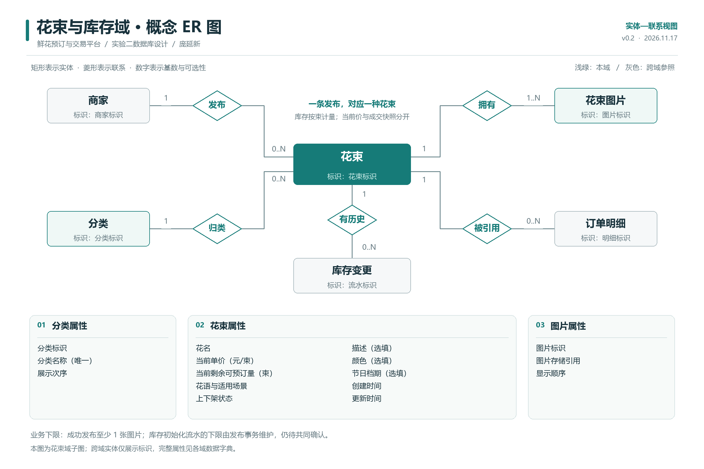
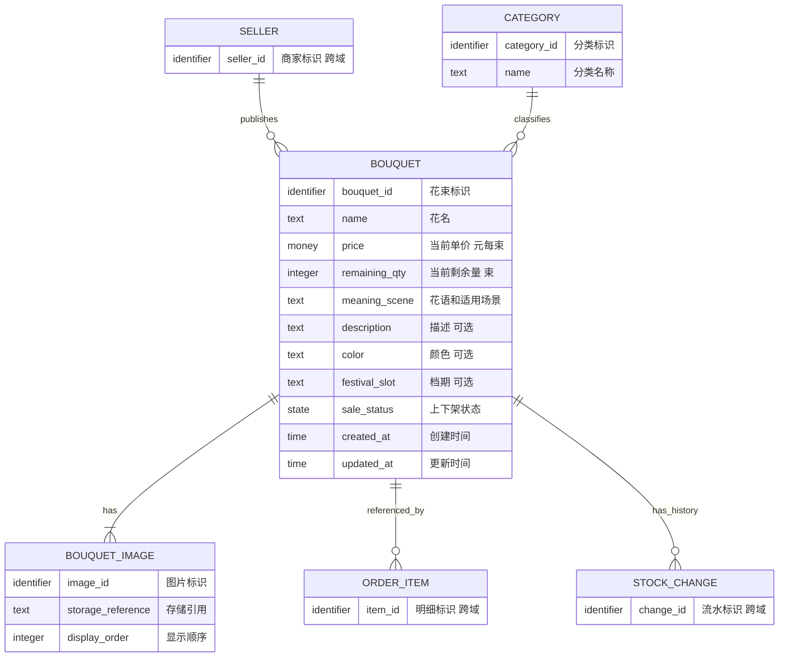

# 花束与库存域 实体属性与业务规则

> 实验二数据库设计｜主责：庞延新（victory0703）｜v0.2｜2026-11-17
> 本稿为待组内复核的设计提案；采用状态以真实提交、讨论与修订为准。

## 1 依据与范围

课程依据为实验二指导书v1.6（2026-11-09）。仓库依据：[实验二分工](../README.md)、[需求简表](../../requirements/requirements.md)、[范围与规则](../../requirements/scope.md)、UC-01/02/06/07及B-03～B-08。相邻接口对照林伟翔2026-11-14的[库存流水字典](../schema/order-status.md)，以及何奕佳11月17日v0.2[订单实体](domain-order.md)/[订单字典](../schema/order.md)、庞华杰新提交的[用户字典](../schema/user.md)与[总体ER](er-overall.md)。本稿按README第9.2节D-01～D-05统稿决定对齐。

本稿核对的仓库版本：[e7e1d78](https://github.com/Longqc666/243-25-project/commit/e7e1d78c608bbfb092f3ed26277a3d6c0551594b)。本域负责花束、分类、图片及当前剩余量；用户、订单和历史流水由相邻域定义。检索与详情只读取数据。

## 2 实体与属性来源

| 实体 | 业务标识 | 属性与来源 | 业务约束 |
|---|---|---|---|
| 花束 | 花束标识 | 花名、当前单价、花语/适用场景、描述、颜色、节日档期：FR-01～04、UC-01/07；剩余量：B-05；上下架状态：FR-01/02；创建和更新时间：UC-01/07 | 一条发布代表一种花束；必有商家、分类；价格>0，剩余量≥0；颜色、档期选填 |
| 分类 | 分类标识 | 分类名称：FR-01、UC-01/07；分类唯一名及sort_no沿用总体ER候选字段，标识和排序为设计需要 | 使用预置分类；本版采用单分类；分类可以尚无花束 |
| 花束图片 | 图片标识 | 存储引用：FR-01/04；显示顺序为列表缩略图与详情展示的设计选择 | 每张图片属于一条花束；成功发布至少一张；图片上限沿用Q-01待确认 |

术语：“剩余可预订数量”表示尚可被新预订扣减的量，单位束；不包含已被有效订单占用的部分。单价单位元/束。“售罄”由余量为0判断，不额外增加一个与上下架重复维护的状态字段。

## 3 本版设计选择

- 当前剩余量仅保存在`bouquet.stock_qty`。不另外复制`bouquet_stock`；这与D-05及相邻流水接口一致，整体事务细节待共同复核。
- 一条花束一个分类；颜色和档期各一个可选值。若确认多选，再增加选项与关联实体，不使用逗号拼接多个值。
- 上新排序暂采用创建时间；同值按花束标识升序。创建时间与最近更新时间分别保存，不因编辑改变默认上新时间。若小组将上新解释为上架时间，应同步FR-03及图表。
- 按总体ER的R3，`bouquet.seller_id → user.id`；发布者须具商家角色，权限由应用校验。seller_profile以user_id为共享主键，仅通过user.id读取店铺资料，不假设它有独立id列。主外键采用D-01的BIGINT UNSIGNED。
- 本域不新增日期窗口算法；最早可送达日期与UC-03共用规则，Q-03继续跟进。

## 4 概念 ER 子图

图采用矩形实体与菱形联系，主图保留标识、基数和可选性；下方分组列出本域属性。浅绿为本域实体，灰色为跨域参照。此次仅重排图形，实体和联系语义保持不变。

[可编辑矢量图](images/bouquet-concept.svg)。下列Mermaid表达相同实体联系；商家、订单明细和库存变更为跨域参照，子图不替代全组总体ER。

| 联系 | 两端基数与可选性 | 来源 |
|---|---|---|
| 商家发布花束 | 商家可有0..N条；每条花束恰好1个商家 | B-03，FR-01/02 |
| 分类包含花束 | 分类可有0..N条；每条花束恰好1个分类 | UC-01分类必填，单分类为本版提案 |
| 花束拥有图片 | 成功发布花束1..N张；每张图片恰好1条花束 | FR-01/04、UC-01/07 |
| 花束被订单明细引用 | 花束0..N条历史明细；每条明细恰好1条花束 | B-04/06/08；订单域v0.2暂定一单一种花束，物理复合唯一键尚不强制一单一行，待共同定稿 |
| 花束有库存变更 | 花束至少1条初始化变更为本版提案，随后0..N条变更；每条变更恰好引用1条花束 | B-05、G3；子图按宽松0..N表示跨域引用，初始化下限由发布事务实现并待共同确认 |

## 5 必须保持的业务规则

| 规则 | 数据及责任落点 |
|---|---|
| 余量非负 | `bouquet.stock_qty >= 0`；下单按数量条件扣减，成功取消回补原数量一次 |
| 当前余量与历史一致 | 每次实际变更与`stock_change`同事务提交；流水保存变更前后快照，不能把所有历史before_qty都要求等于现在的余量 |
| 商家改量不改变已有订单 | 改的是新剩余量，不以有效订单占用数为下限；版本/旧值已变化则拒绝旧表单覆盖 |
| 下架不影响历史订单 | 仅改变花束状态；不级联删除花束、明细或流水 |
| 改价不改历史金额 | 花束保存当前价，订单明细保存成交快照 |
| 仅本人能维护花束 | 登录身份与商家归属由应用校验，外键只保证引用存在 |
| 上架与售罄 | 上架操作时须余量>0；最后一束售出后允许状态仍为已上架、余量0，详情显示售罄 |
| 图片完整 | 完成发布至少一张合法图片，由完整发布操作与校验维护，外键不能独自保证父记录必有图片 |

## 6 交接与复核

数据字典见[bouquet.md](../schema/bouquet.md)，独立关系图见[relations-bouquet.md](../schema/relations-bouquet.md)，规范化见[design-notes.md](../design-notes.md)，走查见[walkthrough.md](../walkthrough.md)第6节。本轮保留何奕佳S1/S2，追加本人S4～S6/S7及待林伟翔复核的S3取消场景草稿。

待共同确认：分类名称唯一性与长度/排序规则、颜色/档期单值、创建时间作为上新时间、初始化流水及零改量是否写流水、Q-12商家改量为0的自动下架。本文不宣称总体ER已整合、同学互评已通过或SQL已执行。
