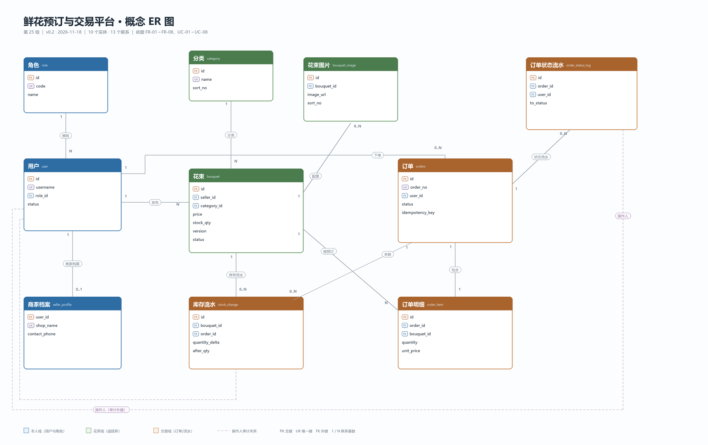

# 概念 ER 图（总体）

> 实验二 · 数据库设计 ｜ 主责人：庞华杰（总体框架与合并）｜ 版本 v0.1 · 2026-11-17
> 依据：[database/README.md](../README.md) 分工与建模约定、[需求简表](../../requirements/requirements.md)、[用例对应](../../requirements/use-cases.md)
> 各域明细：用户与角色 [schema/user.md](../schema/user.md)、订单 [schema/order.md](../schema/order.md)、状态与库存流水 [schema/order-status.md](../schema/order-status.md)；花束域待 T4 定稿

## 1 范围

本图覆盖四项核心业务（发布花束、检索与查看、预订下单、取消订单）及其支撑能力（登录与角色、我的订单）所需保存的信息，共 **10 个实体、13 个联系**。支付、退款、物流、评价等需求阶段已排除的项不建实体。

概念图只画实体名、标识与关键属性，完整字段、类型与约束见第 3 章及各域数据字典；表间主外键连接由 T8 汇总为 schema/relations.md（待花束域定稿后提交），本人域的局部图见 [user-relations.png](../schema/user-relations.png)。

## 2 图

图 2-1　鲜花预订与交易平台概念 ER 图（v0.1）

## 3 实体与标识

| 实体（表名） | 标识 | 关键属性 | 来源需求 | 主责 | 状态 |
|---|---|---|---|---|---|
| role 角色 | `id` | code、name | FR-08、B-03 | 庞华杰 | v0.1 |
| user 用户 | `id` | username（UK）、password_hash、phone（UK）、role_id（FK）、status | FR-08、B-02、NFR-03 | 庞华杰 | v0.1 |
| seller_profile 商家档案 | `user_id`（PK/FK） | shop_name（UK）、contact_phone、pickup_address | FR-01、FR-04 | 庞华杰 | v0.1 |
| category 分类 | `id` | name（UK）、sort_no | FR-01、FR-03 | 庞延新 | 待定稿 |
| bouquet 花束 | `id` | seller_id（FK）、category_id（FK）、name、price、stock_qty、status | FR-01～FR-05 | 庞延新 | 待定稿 |
| bouquet_image 花束图片 | `id` | bouquet_id（FK）、image_url、sort_no | FR-01、FR-04 | 庞延新 | 待定稿 |
| orders 订单 | `id` | order_no（UK）、user_id（FK）、status、total_amount、idempotency_key（UK） | FR-05、FR-06、NFR-02 | 何奕佳 | v0.1 |
| order_item 订单明细 | `id` | order_id（FK）、bouquet_id（FK）、quantity、unit_price | FR-05、B-08 | 何奕佳 | v0.1 |
| order_status_log 状态流水 | `id` | order_id（FK）、user_id（FK）、from_status、to_status | FR-07、B-06 | 林伟翔 | v0.1 |
| stock_change 库存流水 | `id` | bouquet_id（FK）、order_id（FK）、change_type、quantity_delta、after_qty | B-05、NFR-02 | 林伟翔 | v0.1 |

## 4 联系、基数与可选性

| 编号 | 联系 | 基数 | 可选性 | 外键落点 | 说明 |
|---|---|---|---|---|---|
| R1 | 角色—用户 | 1:N | 用户侧必选 | `user.role_id → role.id` | 一个角色可被多个用户使用；每个账号同一时刻只有一种角色（B-03） |
| R2 | 用户—商家档案 | 1:0..1 | 档案侧必有、用户侧可选 | `seller_profile.user_id → user.id` | 只有商家有档案；档案不能脱离用户存在 |
| R3 | 用户—花束 | 1:N | 花束侧必选 | `bouquet.seller_id → user.id` | 商家发布 0..N 个花束；顾客不发布（FR-02） |
| R4 | 分类—花束 | 1:N | 花束侧必选 | `bouquet.category_id → category.id` | 一种花束属于一个分类，一个分类含多种花束 |
| R5 | 花束—花束图片 | 1:0..N | 图片侧必有 | `bouquet_image.bouquet_id → bouquet.id` | 一条发布可有多张图，至少一张（FR-01） |
| R6 | 用户—订单 | 1:0..N | 订单侧必选 | `orders.user_id → user.id` | 一名顾客可有多笔历史订单；单笔订单必属一名顾客 |
| R7 | 订单—订单明细 | 1:1..N | 明细侧必有 | `order_item.order_id → orders.id` | 当前一单一花束（N=1），结构预留多花束 |
| R8 | 花束—订单明细 | 1:N | 明细侧必选 | `order_item.bouquet_id → bouquet.id` | 一种花束可出现在多条历史订单中；下架不影响历史订单 |
| R9 | 订单—状态流水 | 1:0..N | 流水侧必有 | `order_status_log.order_id → orders.id` | 每次状态变化写一行，只追加（G3） |
| R10 | 花束—库存流水 | 1:0..N | 流水侧必有 | `stock_change.bouquet_id → bouquet.id` | 每次剩余量变化写一行，只追加（G3） |
| R11 | 订单—库存流水 | 1:0..N | 流水侧可选 | `stock_change.order_id → orders.id` | 商家调整库存时 `order_id` 为空（NULL） |
| R12 | 用户—状态流水（操作人） | 1:0..N | 流水侧必选 | `order_status_log.user_id → user.id` | 审计字段，记录谁执行了状态变更 |
| R13 | 用户—库存流水（操作人） | 1:0..N | 流水侧可选 | `stock_change.user_id → user.id` | 系统自动写入时为空，见 README 决定 D-04 |

## 5 建模说明

**（1）用户只用一张表。** 顾客、商家、管理员不拆成三张表，而是 `user` + `role` 字典。理由有三：B-02 使用预置账号、B-03 规定同一账号同一时刻只有一种角色，因此“一人一行”成立；登录时只查一张表即可确定身份与数据范围；若拆三表，`orders.user_id`、`bouquet.seller_id`、流水表的操作人都无法用单一外键指向“用户”，需要三列或额外的类型标记，反而破坏引用完整性。仓库根目录的 `flowershopsystem.sql` 是早期按 `admin`/`customer`/`employee` 三表写的遗留脚本，本设计明确不沿用，理由同上。

**（2）商家档案单独成表。** 店铺名、店铺简介、自提地址只对商家有意义，并入 `user` 会让顾客与管理员行出现大量 NULL，且无法对“仅商家”施加唯一约束；用共享主键的 1:0..1 表承载，语义更清楚。

**（3）订单与明细分离。** FR-05 当前只允许一笔订单一种花束，本可以压成一张表；但单价快照（B-08）、数量与行金额属于明细的职责，订单表只保留合计与状态。保留 `order_item` 使“一单多花束”的后续扩展不改接口，也让快照字段有明确归属。

**（4）当前值与流水并存。** `bouquet.stock_qty` 保存当前剩余量，`stock_change` 保存每次变化。两者在同一事务内写入，属于有意冗余，理由见 [schema/user.md](../schema/user.md) 第 6 节与组内设计说明；它不违反 3NF，因为保存的是不同时间点的状态，而不是同一事实的重复。

**（5）状态口径。** `orders.status` 与 `order_status_log.from_status/to_status` 使用同一枚举：有效 / 已取消 / 已完成；“已完成”按 Q-10 仅占位、本期不产生流转。该占位与 Q-10 的“两态”表述存在差异，已登记为待确认项，见 README 决定 D-03。

**（6）操作人关系用虚线。** 流水表的 `user_id` 是审计外键，不是业务归属，画成虚线以免与“顾客下单”混淆。

## 6 与各域文件的一致性

| 域 | 文件 | 本图对应 | 差异或待办 |
|---|---|---|---|
| 用户与角色 | [schema/user.md](../schema/user.md) | role、user、seller_profile | 无 |
| 订单 | [schema/order.md](../schema/order.md) | orders、order_item | 待确认是否增加 `bouquet_name_snapshot`，会影响 order_item 字段 |
| 状态与库存流水 | [schema/order-status.md](../schema/order-status.md) | order_status_log、stock_change | 主键类型已由 README 决定统一为 BIGINT，对方待确认项 1 可关闭 |
| 花束与库存 | 待 T4 提交 | category、bouquet、bouquet_image | 字段与状态枚举待定稿；本图仅画标识与关键属性 |

## 7 待确认项

| # | 问题 | 当前处理 | 影响 |
|---|---|---|---|
| 1 | 花束域字段（颜色、节日档期、图片数量上限） | 图中不展开，等 T4 定稿 | ER 与关系图需二次合并 |
| 2 | 是否保存花束名称快照 | 建议追加 `order_item.bouquet_name_snapshot` | 历史订单展示 |
| 3 | 状态是否保留“已完成” | 按 Q-10 预留不流转，登记教师确认 | 两处 CHECK |
| 4 | 商家停用后其花束是否仍可被检索 | 待花束域与检索规则共同约定 | W-05 走查结论 |
| 5 | 分类是否允许多级 | 当前按单级设计（FR-01 只要求分类） | category 是否加 parent_id |

---

## 变更记录

| 版本 | 日期 | 内容 | 修改人 |
|---|---|---|---|
| v0.1 | 2026-11-17 | 建立总体 ER 框架：10 实体、13 联系、基数与可选性、建模说明与一致性核对 | 庞华杰 |
