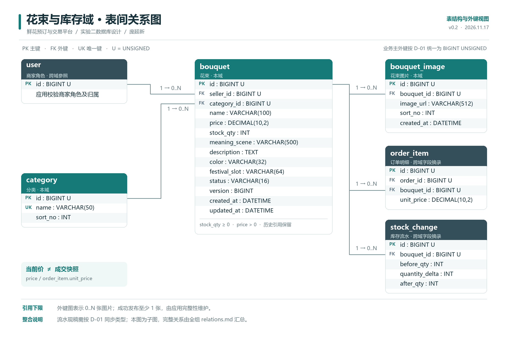
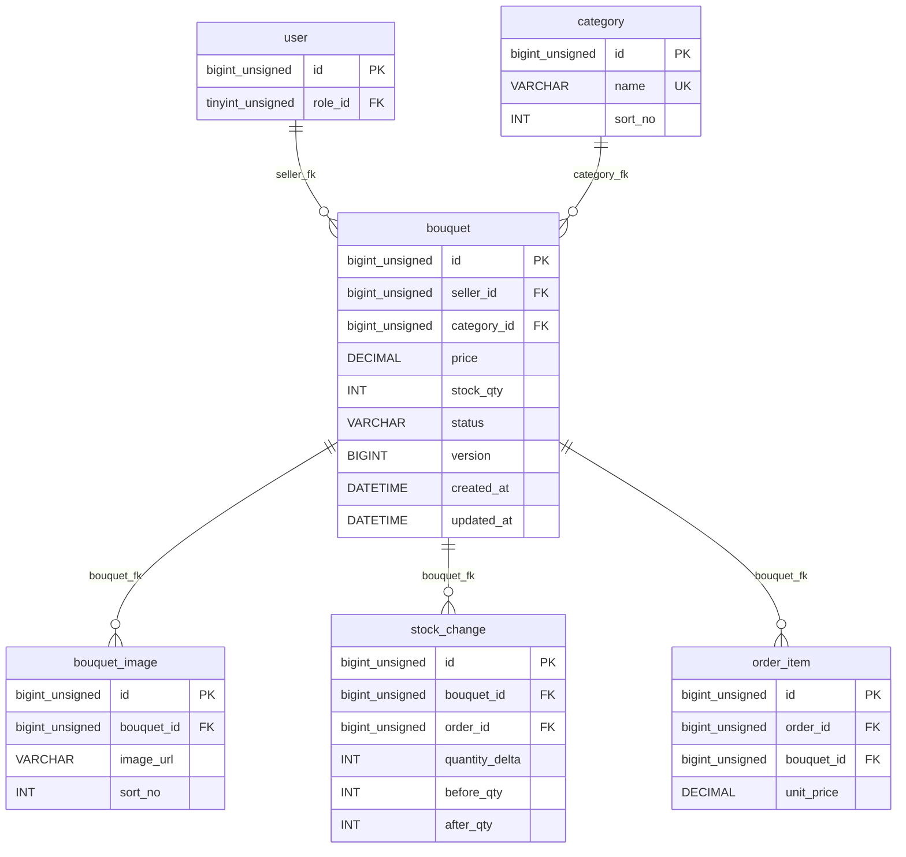

# 花束与库存域 表间关系子图

> 庞延新（victory0703）｜v0.2｜2026-11-17。按main 72c9f9e及README D-01～D-05对齐，供林伟翔合并全组关系图。

图中U为UNSIGNED的排版缩写，实际类型仍为BIGINT UNSIGNED；PK/FK/UK分别标记主键、外键和唯一键。连线从被引用主键接到相应外键行，跨域表只摘录接口字段。

[SVG](images/bouquet-relations.svg)。依据：[本域字典](bouquet.md)、[用户字典](user.md)、[订单字典](order.md)、[流水字典](order-status.md)。图中BIGINT UNSIGNED是本版主外键类型；Mermaid用bigint_unsigned避免空格。灰色为相邻域表。流水现稿仍为有符号BIGINT，图中展示D-01要求的目标类型，需对应负责人同步。

| 外键列 | 目标主键 | 类型/可空 | 基数及责任 |
|---|---|---|---|
| bouquet.seller_id | user.id | BIGINT UNSIGNED，非空 | 用户0..N花束，每花束1个发布者；应用验证商家角色及权限 |
| bouquet.category_id | category.id | BIGINT UNSIGNED，非空 | 分类0..N花束，每花束1分类 |
| bouquet_image.bouquet_id | bouquet.id | BIGINT UNSIGNED，非空 | 每图1花束；FK直接允许父花束0..N图，发布操作维护至少1张 |
| stock_change.bouquet_id | bouquet.id | 目标BIGINT UNSIGNED，非空 | 每流水1花束；流水稿需按D-01同步 |
| order_item.bouquet_id | bouquet.id | BIGINT UNSIGNED，非空 | 已对照订单v0.2；花束0..N历史明细，每明细1花束 |

user.role_id→role.id、seller_profile.user_id→user.id、order_item.order_id→orders.id等不以花束为中心的连线由全组图展示。seller_profile没有独立id，商家详情经user.id读取档案，不在bouquet重复保存店铺名。

本域外键RESTRICT删除，保留历史引用。当前价bouquet.price与历史快照order_item.unit_price分别保存。字段完整长度、默认值和约束以本域字典为准；子图不替代全组relations.md。总体概念ER中图片业务下限应为成功发布1..N，数据库FK图0..N另注明应用保证，供整合时统一。
