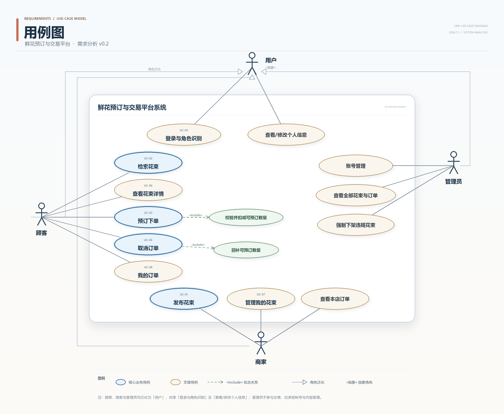

# UC-01 发布花束 —— 详细用例

> 实验一 · 需求分析 ｜ 主责人：庞华杰（UC-01）｜ 版本 v0.1 · 2026-11-06
> 对应需求：FR-01（主）、FR-08；约定 B-03、B-04；待确认 Q-01、Q-08 ｜ 依据材料：实验一指导书 v1.7、第 2 次课任务单 v1.4
> 2026-11-07 规则同步：单位固定为束，数量按 B-05 表示剩余量；其他暂定项保持原状态。详见[规则记录](../records/rules-uc02-uc06-2026-11-07.md)。
> 相邻用例：UC-07 管理我的花束（编辑、调整数量、上下架）；本文件只描述发布。

## 0 完整用例图

## 1 用例基本信息

| 字段 | 内容 |
|---|---|
| 编号 | UC-01 |
| 名称 | 发布花束 |
| 目标 | 商家把一款花束登记为一条可管理的商品记录，形成"已下架（待上架）"状态，供后续上架、检索与预订使用。 |
| 主要参与者 | 商家 |
| 次要参与者 | 顾客（间接受影响：花束上架后才可被检索与预订）；平台管理员（可强制下架违规花束，不属本用例）。 |
| 触发条件 | 商家在"我的花束"页面点击"发布花束"并提交表单。 |
| 前置条件 | C1 商家已使用预置商家账号登录，系统已知其身份与角色为"商家"（B-02、B-03、FR-08）。 C2 商家已进入商家端"我的花束"页面；列表为空时该页面提供"发布花束"入口。 C3 系统可正常访问数据库与图片存储。 C4 说明：**"发布后是否立即对顾客可见"不列为前置条件**，按 Q-08 暂定发布后为"已下架（待上架）"，是否上架由 UC-07 决定。 |
| 成功后置条件 | P1 新增 1 条花束记录，含花名、单价与单位、可预订数量、花语/适用场景、分类、图片、颜色与节日档期（可选）、商家标识、状态"已下架（待上架）"、创建时间与更新时间（B-04）。 P2 该记录出现在当前商家"我的花束"列表首行；顾客端检索与详情均不可见（Q-08）。 P3 记录可由商家在 UC-07 中编辑、调整可预订数量、上架或下架；此时尚无订单，不涉及单价快照。 |
| 失败后保证 | F1 不生成任何花束记录。 F2 表单中已填写的内容保留，供商家修正后重新提交；仅图片因上传失败需重新选择。 F3 已有花束、其可预订数量与订单均不受影响。 F4 商家收到可定位的失败原因（哪个字段、什么规则）。 |

## 2 正常流程

| 步骤 | 参与者动作 | 系统响应与校验点 |
|---|---|---|
| 1 | 在"我的花束"页面点击"发布花束"。 | 展示发布表单：花名、单价、可预订数量、花语/适用场景、分类、图片为必填，单位固定展示“束”；描述、颜色、节日档期为选填。 |
| 2 | 填写各字段并上传图片（jpg/png，单张 ≤ 2 MB，暂定按 Q-01）。 | 前端对图片格式、大小与必填项做即时提示，不阻塞继续填写。 |
| 3 | 点击"提交"。 | 接收请求，以本次请求的幂等键标识该次提交，供第 6 步判重。 |
| 4 | — | 校验登录状态与角色为"商家"；不通过转 A1。 |
| 5 | — | 校验必填项、文本长度、单价与可预订数量取值范围、图片格式与大小；不通过按字段转 A2—A5，逐项提示且不保存。 |
| 6 | — | 按幂等键判重：若为重复请求，直接返回首次成功结果，不再新增记录，转 A6。 |
| 7 | — | 在同一事务内写入花束记录：商家标识取自当前登录态（不采用前端传入值），状态置为"已下架（待上架）"，写入创建时间与更新时间；写入失败转 A7。 |
| 8 | — | 提示"发布成功，花束已保存为待上架"，跳转回"我的花束"列表，新记录显示在首行。 |
| 9 | 在列表中查看该记录。 | 展示花名、缩略图、单价与单位、可预订数量、状态"已下架（待上架）"及"编辑""调整数量""上架"入口。 |
| 10 | — | 用例结束。后续编辑、改量、上架由 UC-07 完成，本用例不改变可预订数量、不生成订单。 |

## 3 字段与校验

| 字段 | 是否必填 | 类型/取值 | 校验规则 |
|---|---|---|---|
| 花名 | 是 | 字符串 | 去首尾空白后非空；长度上限待组内确认 |
| 单价 | 是 | 十进制（保留 2 位小数） | 大于 0，不超过上限（上限待确认） |
| 单位 | 系统固定展示 | 束 | 单价按元/束，数量按束；不允许改为支（B-05） |
| 可预订数量 | 是 | 整数（束） | 表示初始剩余可预订数量，≥ 0；发布时允许为 0，但为 0 时不可上架（B-05） |
| 花语/适用场景 | 是 | 文本 | 非空；长度上限待组内确认 |
| 分类 | 是 | 枚举 | 须属于预置分类 |
| 图片 | 是 | jpg/png | 至少 1 张，单张 ≤ 2 MB；张数上限待确认（Q-01） |
| 颜色、节日档期 | 否 | 枚举或文本 | 若填写须属于预置选项 |
| 描述 | 否 | 文本 | 长度上限待组内确认 |
| 上下架状态 | 系统维护 | 已下架（待上架） | 发布后固定为该值，后续由 UC-07 变更 |
| 商家标识 | 系统维护 | 取自当前登录态 | 不接受前端传入，用于归属与越权判定 |

## 4 异常与备选流程

### A1 未登录或角色不符（分支点：第 4 步）

- 触发：会话已失效、未登录，或以顾客、管理员账号直接提交发布请求。
- 处理：引导至登录页并提示"请使用商家账号登录"；顾客端不展示"发布花束"入口（FR-08）。
- 结束：不生成记录，表单内容不落库（F1）。
- 依据：FR-08、B-02、B-03。

### A2 必填项缺失（分支点：第 5 步）

- 触发：花名、单价、可预订数量、花语/适用场景、分类、图片中任一项为空；单位由系统固定为“束”。
- 处理：逐项高亮并提示缺失字段，阻止提交；已填内容保留。
- 结束：不生成记录（F1、F2）。
- 依据：FR-01。

### A3 单价或可预订数量取值非法（分支点：第 5 步）

- 触发：单价为空、非数字、≤ 0 或超过允许上限；可预订数量为小数、负数或非整数。
- 处理：分别提示"单价格式或范围不正确""可预订数量必须为不小于 0 的整数"，不保存。
- 结束：不生成记录（F1、F2）。
- 依据：FR-01；单价上限与小数位规则待确认。

### A4 文本字段超长（分支点：第 5 步）

- 触发：花名、花语/适用场景等超出约定长度上限。
- 处理：提示具体字段及允许的最大长度，不保存。
- 结束：不生成记录（F1、F2）。
- 依据：FR-01；长度上限待组内确认。

### A5 图片不符合要求（分支点：第 2、5 步）

- 触发：图片不是 jpg/png，或单张超过 2 MB，或一张都未上传。
- 处理：提示允许的格式与大小上限，要求重新选择；其他字段内容保留。
- 结束：不生成记录（F1、F2）。
- 依据：Q-01（暂定规则）。

### A6 重复提交（分支点：第 6 步）

- 触发：商家双击"提交"、浏览器重发或断网后手工重试，同一幂等键的请求到达 2 次以上。
- 处理：返回首次成功结果，不再新增记录，不重复写入图片。
- 结束：系统内只保留 1 条花束记录（NFR-02 同理）。
- 依据：NFR-02。

### A7 写入失败或图片上传中断（分支点：第 7 步）

- 触发：图片上传中途断网、数据库写入失败或事务提交失败。
- 处理：整个发布操作回滚，不留下无图片或半条记录；提示"发布失败，请重试"。
- 结束：不生成记录，已有数据不变（F1、F3）。
- 依据：FR-01、B-04。

### A8 商家放弃填写并离开页面（分支点：第 1—3 步）

- 触发：商家未提交即关闭或离开页面。
- 处理：不保存任何内容；是否提供草稿暂存待组内确认。
- 结束：不生成记录。
- 依据：FR-01；草稿能力为待确认项。

## 5 验收条件

以下使用虚构商品情境，作为需求走读与后续测试依据，当前均未执行。

| 编号 | 给定 | 当 | 则 |
|---|---|---|---|
| AC-UC01-01 | 商家 A 已登录；A 的"我的花束"列表为空。 | A 完整填写花名"向日葵思慕"、单价 99 元、单位"束"、可预订数量 10、花语"沉默的爱"、分类"毕业"，上传 1 张 jpg 图片并提交。 | 发布成功；生成 1 条状态为"已下架（待上架）"的记录，出现在 A 的列表首行；顾客按花名检索不到该花束（Q-08）。 |
| AC-UC01-02 | 商家 A 打开空白发布表单。 | A 未填花名即提交。 | 提示缺少花名，其他已填内容保留；不生成记录（FR-01）。 |
| AC-UC01-03 | 商家 A 已填好其余字段。 | 单价分别填 0、-5、abc 后提交。 | 均提示单价格式或范围不正确；均不生成记录。 |
| AC-UC01-04 | 商家 A 已填好其余字段。 | 可预订数量分别填 1.5、-1、abc 后提交。 | 均提示须为不小于 0 的整数；均不生成记录。 |
| AC-UC01-05 | 商家 A 已填好其余字段。 | 上传 5 MB 的 png 或扩展名为 .gif 的文件后提交。 | 提示格式或大小不符合要求，要求重新上传；不生成记录（Q-01）。 |
| AC-UC01-06 | 商家 A 完整填写一款花束。 | A 连续点击"提交"3 次。 | 只生成 1 条记录，列表不出现重复项；3 次响应返回同一记录标识。 |
| AC-UC01-07 | 商家 A 已发布花束 X（状态"已下架（待上架）"）。 | 顾客按花名检索，随后 A 在 UC-07 中将 X 上架，顾客再次检索。 | 第一次检索不到 X；上架后可检索到 X，且可进入详情（FR-03、FR-04）。 |
| AC-UC01-08 | 商家 A 已登录，商家 B 也存在。 | A 在发布请求中把商家标识改为 B 后提交。 | 记录仍归 A（商家标识取自登录态）；B 的"我的花束"中不出现该记录；A 的列表中出现。 |
| AC-UC01-09 | 商家 A 完整填写一款花束，数据库在写入时失败。 | A 点击"提交"。 | 提示"发布失败，请重试"；不生成任何记录；A 的其他花束与库存不变。 |
| AC-UC01-10 | 用户未登录。 | 直接访问发布入口并提交表单。 | 引导至登录页；登录后返回发布页；期间不生成记录（FR-08）。 |

## 6 关联需求与相邻用例

- **主关联**：FR-01（发布花束）。
- **相关需求**：FR-08（登录与角色）、FR-02（发布后的管理，由 UC-07 承担）、FR-03/FR-04（上架后的检索与详情）、NFR-02（重复提交只产生一次效果）；约定 B-03（由商家发布）、B-04（一条发布 = 一种花束，含可预订数量）。
- **相邻用例**：下游为 UC-07 管理我的花束（编辑、改量、上下架）→ UC-02 检索花束 / UC-06 查看花束详情 → UC-03 预订下单。**发布与管理各自独立成用例**，不把编辑与上下架写进本用例的主流程。

## 7 待确认与暂定规则

| 规则 | 当前处理 | 依据 | 对本用例的影响 |
|---|---|---|---|
| 图片是否必填、格式、大小、张数 | 暂定必填，jpg/png，单张 ≤ 2 MB，张数上限未定 | Q-01 | 影响第 5 步校验与 A5、AC-UC01-05；若改为选填，需同步修改前置与验收 |
| 发布后是否默认下架 | 暂定默认"已下架（待上架）"，手动上架后才对顾客可见 | Q-08 | 决定 P2 与 AC-UC01-01、AC-UC01-07 的预期结果 |
| 计价与库存单位 | 已约定为“束”，数量表示剩余量 | B-05；2026-11-07规则记录 | 固定展示单位，发布、检索、详情与下单一致 |
| 单价上限与小数位 | 未定 | FR-01 | 影响 A3 的判定边界 |
| 是否支持草稿暂存 | 暂定不支持 | FR-01 | 影响 A8；若支持需新增后置条件与验收 |
| 是否支持批量发布 | 暂定不支持，一次一条 | FR-01 | 影响主流程与 NFR-02 的幂等粒度 |

## 8 本人负责模块说明（报告第 2 节素材）

- **名称**：发布花束（花束信息登记与初始状态）。
- **功能范围**：从商家打开发布表单，到校验通过并生成"已下架（待上架）"的花束记录；不含发布后的编辑、改量、上下架（UC-07），不含检索、下单与取消，不含支付、退款、物流与评价（排除范围）。
- **输入**：商家身份与会话、花名、单价与单位、可预订数量、花语/适用场景、分类、图片、可选的描述/颜色/节日档期、幂等键。
- **输出**：一条新的花束记录（含商家标识与状态）、列表中的展示、可定位的成功或失败提示。
- **与其他模块的关系**：为 UC-07 提供可管理的记录；为 UC-02/UC-06 提供花名、图片、价格、可预订数量与上下架状态；为 UC-03 提供可预订数量这一库存基线。本模块本身不生成订单、不扣减库存。
- **本人具体工作**：起草 UC-01 的字段与主流程；把原 Issue #1 中混写的 FR-02 管理流程拆分为独立的 UC-07；补充 A1—A8 异常场景与 AC-UC01-01—AC-UC01-10；核对 FR-01、Q-01、Q-08 与用例图的一致性。

## 9 个人贡献与反思（报告第 7 节素材）

- **贡献**：UC-01 详细用例与验收条件起草；将"发布"与"管理我的花束"拆成 UC-01、UC-07 两个用例，分别对应 FR-01、FR-02；在 Issue #1、#5 中维护完成条件与成果链接。
- **反思一**：初稿把编辑、调整数量、上下架都写进"发布花束"的第六节，导致一个用例同时承担 FR-01 与 FR-02，主流程与验收条件无法一一对应。与组内走读后拆分为 UC-07，本文件只保留发布。
- **反思二**：初稿把"发布后立即对顾客可见"当作默认，未注意 S-01 只提出该问题、任务单并未给定答案。现按 Q-08 暂定为"已下架（待上架）"，并把是否可见写进验收条件而不是前置条件。
- **反思三**：初稿未写重复提交。补 A6 与 AC-UC01-06 后，发布接口与下单、取消一样按幂等键判重，避免双击产生两条花束记录。

## 10 提交与自查清单

- [x] 用例基本字段齐全（编号、名称、目标、参与者、触发、前后置、失败后保证）
- [x] 正常流程按"参与者动作—系统响应"逐步描述
- [x] 异常/备选场景覆盖必填、取值、图片、重复提交、写入失败与放弃填写
- [x] 验收条件采用"给定—当—则"，覆盖正常流程与至少 3 个异常
- [x] 写明与 FR-01、FR-08、Q-01、Q-08 的对应关系
- [x] 与 UC-07 的职责边界、状态名称一致
- [ ] 组内走读与互评意见处理结果（待补充）
- [x] 成果同步到仓库 `requirements/uc-01-publish-bouquet.md`

**关联 Issue**：[#1 发布花束](https://github.com/Longqc666/243-25-project/issues/1) ｜ **成果位置**：`requirements/uc-01-publish-bouquet.md`
