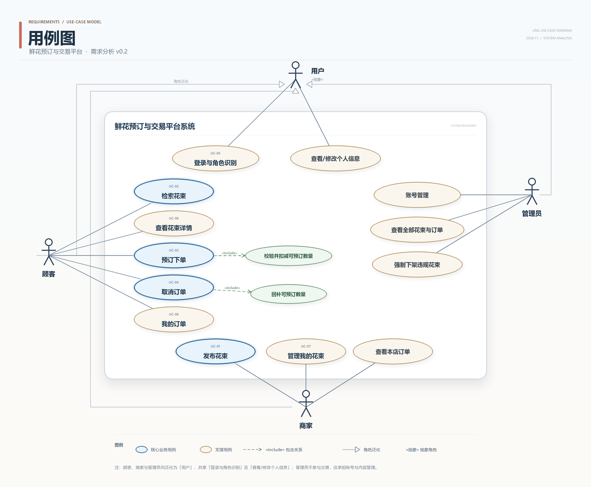

# UC-03 预订下单 —— 详细用例

> 实验一 · 需求分析 ｜ 主责人：何奕佳（UC-03）｜ 版本 v0.1 · 2026-11-02
> 对应需求：FR-05（主）、FR-02、FR-04、FR-08；NFR-01、NFR-02 ｜ 依据材料：实验一指导书 v1.7、第 2 次课任务单 v1.4

2026-11-07 口径同步：计价与数量按“束”；可预订数量表示剩余量，成功下单扣减 N、成功取消仅回补原订单 N 一次。日期等其他暂定规则未因此自动确认。详见[规则记录](../records/rules-uc02-uc06-2026-11-07.md)。

## 0 完整用例图



## 1 用例基本信息

| 字段 | 内容 |
|---|---|
| 编号 | UC-03 |
| 名称 | 预订下单 |
| 目标 | 顾客把选定的在售花束预留为一条有效订单，系统占用相应可预订数量。 |
| 主要参与者 | 顾客 |
| 次要参与者 | 商家（间接受影响：可预订数量减少，订单在其"本店订单"中可见） |
| 触发条件 | 顾客在花束详情页点击"立即预订"并提交订单信息。 |
| 前置条件 | C1 顾客已使用预置的顾客账号登录，系统已知其身份与角色（B-02、FR-08）。<br>C2 顾客已从检索结果进入该花束详情页，页面已加载花束名称、图片、单价、剩余可预订数量与可送达日期范围。<br>C3 说明：花束"是否仍上架""是否还有可预订数量"**不列为前置条件**——它们在提交瞬间可能已被改变，必须在流程第 2—3 步重新校验，否则并发与下架情形无法表达。 |
| 成功后置条件 | P1 生成 1 条状态为"有效"的订单，含订单号、顾客、花束、数量、下单时单价快照（B-08）、金额、送达日期、履约方式（自提/配送）、下单时间。<br>P2 该花束可预订数量减少 N，终值不小于 0（B-05）。<br>P3 订单出现在"我的订单"（UC-08）；若减少后为 0，UC-06详情显示"已售罄"，新的UC-02检索结果不再包含该花束（FR-03、FR-04）。 |
| 失败后保证 | F1 不产生任何新的有效订单。<br>F2 该花束可预订数量保持不变。<br>F3 已有有效订单及其占用的数量不受影响。<br>F4 顾客收到可定位的失败原因；表单类失败保留顾客已填的数量、日期与履约方式。 |

## 2 正常流程

| 步骤 | 参与者动作 | 系统响应与校验点 |
|---|---|---|
| 1 | 在详情页选择数量（默认 1 束）、送达日期、履约方式（自提/配送），点击"立即预订"。 | 接收请求，以本次请求的幂等键标识该次提交，供第 6 步判重。 |
| 2 | — | 校验登录状态与角色为顾客；不通过转 A1。 |
| 3 | — | 校验该花束当前为"已上架"且可预订数量大于 0；不通过转 A2。 |
| 4 | — | 校验数量为 1—99 的整数，且不超过当前可预订数量；不通过转 A3。 |
| 5 | — | 校验送达日期在"次日～30 天"窗口内，属节日档期时至少提前 3 天；不通过转 A4。 |
| 6 | — | 按幂等键判重：若为重复请求，直接返回首次结果（同一订单号），不再生成订单，转 A5。 |
| 7 | — | 以"可预订数量 ≥ 本次数量"为条件原子扣减库存，生成状态为"有效"的订单并写入单价快照与下单时间；若扣减未命中任何记录，转 A6。 |
| 8 | — | 显示下单成功摘要：订单号、花束、数量、金额、送达日期与方式、下单时间，并提示"可在我的订单中查看或取消"。 |
| 9 | 点击"查看我的订单"。 | 进入 UC-08 查看我的订单。 |

## 3 异常与备选流程

### A1 未登录或角色不符（分支点：第 2 步）

- 触发：会话已失效、未登录，或以商家账号访问下单入口。
- 处理：引导至登录页并提示"请使用顾客账号登录"；登录成功后返回该花束详情页，保留已选数量、日期与履约方式。
- 结束：本次请求结束，不生成订单，可预订数量不变（F1、F2）。
- 依据：FR-08。

### A2 花束不可预订（下架或售罄，分支点：第 3 步）

- 触发：顾客停留在详情页期间商家将其下架；或可预订数量已被其他顾客减为 0。
- 处理：拒绝并区分提示——下架提示"该花束已下架，无法预订"，售罄提示"该花束已售罄"；同时把"立即预订"置为不可用，并刷新页面上的剩余数量。
- 结束：不生成订单，数量不变；该花束的历史有效订单仍可查看（FR-02）。
- 依据：FR-02、FR-04、B-05。

### A3 数量不合法或超过剩余数量（分支点：第 4 步）

- 触发：数量为 0、负数、小数或大于 99；或页面打开后剩余数量由 5 降为 1，顾客仍提交 2 束。
- 处理：拒绝并逐项说明原因（"数量应为 1—99 的整数""当前仅剩 1 束，请调整数量"），保留日期与履约方式。
- 结束：不生成订单，可预订数量不变。
- 依据：FR-05、Q-02（限购区间为暂定规则）。

### A4 送达日期不合法（分支点：第 5 步）

- 触发：送达日期早于次日、晚于 30 天，或属节日档期但未提前 3 天。
- 处理：拒绝并提示可选日期区间，日期控件标红，保留数量与履约方式。
- 结束：不生成订单，可预订数量不变。
- 依据：FR-05、Q-03（窗口与节日提前量为暂定规则）。

### A5 重复提交（分支点：第 6 步）

- 触发：顾客重复点击、浏览器重发或断网后手工重试，同一幂等键的请求到达 2 次以上。
- 处理：返回首次成功结果（同一订单号与金额），不重复扣减库存，不生成第二条订单。
- 结束：以首次请求的结果结束；系统内只保留 1 条有效订单。
- 依据：NFR-02、S-05。

### A6 并发抢占失败（分支点：第 7 步）

- 触发：第 3—5 步校验通过后、扣减库存时，另一顾客的请求先完成，剩余数量已小于本次数量（典型情形：两人同抢最后 1 束）。
- 处理：本次扣减未命中即回滚，提示"该花束刚刚被订走，当前仅剩 X 束"，并刷新数量与按钮状态。
- 结束：不生成订单，数量终值不小于 0；并发双方合计只产生 1 条有效订单。
- 依据：NFR-01、S-04、B-05。
- 说明：本条只约定业务结果，不规定数据库锁或具体实现方式（课程明确本次不要求设计锁）。

## 4 验收条件

| 编号 | 给定 | 当 | 则 |
|---|---|---|---|
| AC-UC03-01 | 花束 A 已上架、可预订数量 5、单价 199；顾客 C 已登录。 | C 选择 2 束、送达日期为后天、自提并提交。 | 生成 1 条"有效"订单，金额 398，A 的可预订数量变为 3，订单出现在"我的订单"。 |
| AC-UC03-02 | A 已上架但可预订数量为 0。 | 顾客提交预订。 | 拒绝并提示"已售罄"，不生成订单，数量仍为 0（FR-04）。 |
| AC-UC03-03 | A 可预订数量为 1；顾客 C1、C2 同时各提交 1 束。 | 两请求并发到达，重复 10 轮。 | 每轮仅 1 单成功，另一单提示库存不足；数量终值为 0，有效订单恒为 1（NFR-01）。 |
| AC-UC03-04 | A 可预订数量为 3。 | 顾客提交 5 束。 | 拒绝并提示当前仅剩 3 束；不生成订单；数量仍为 3。 |
| AC-UC03-05 | 今天为 D，A 正常在售。 | 分别提交送达日期 D-1、D+31、节日档期仅提前 1 天。 | 三种情况均拒绝并提示可选区间；均不生成订单。 |
| AC-UC03-06 | A 上首次提交已成功（订单 O1）。 | 同一请求重复到达 3 次。 | 只有 O1 一条订单；库存只扣减 1 次；三次响应返回同一订单号 O1（NFR-02）。 |
| AC-UC03-07 | 顾客停留在 A 的详情页，商家将 A 下架。 | 顾客点击"立即预订"。 | 拒绝并提示"已下架"；不生成订单；A 的历史有效订单仍可查看（FR-02）。 |
| AC-UC03-08 | 用户未登录。 | 访问下单入口。 | 引导至登录页；登录后返回该详情页；期间不产生订单（FR-08）。 |

## 5 关联需求与相邻用例

- **主关联**：FR-05（预订下单）。
- **相关需求**：FR-02（上下架与可预订数量维护）、FR-04（售罄显示与入口禁用）、FR-08（角色与登录）、NFR-01（并发一致性）、NFR-02（幂等）；约定 B-05（剩余量非负，下单扣减、取消仅回补一次）、B-08（单价快照）、Q-02、Q-03（暂定规则）。
- **相邻用例**：上游为 UC-02 检索花束与 UC-06 查看花束详情（直接入口）；下游为 UC-08 查看我的订单、UC-04 取消订单。**下单与取消各自独立成用例**，不用包含/扩展连线表达先后顺序。

## 6 待确认与暂定规则

| 规则 | 当前处理 | 依据 | 对本用例的影响 |
|---|---|---|---|
| 限购 1—99 束 | 暂定 | Q-02 | 超限走 A3 |
| 可预订窗口为次日至 30 天后 | 暂定 | Q-03 | 非法日期走 A4 |
| 节日档期需提前 3 天 | 暂定；"节日档期"的清单未定义 | Q-03 | 需先定义节日范围，否则 A4 无法判定 |
| 同一用户能否预订自己发布的花束 | 待确认；B-03只规定当前账号角色，未给出切换角色后购买本人花束的规则，不预设允许或禁止 | B-03；相关重复下单问题见Q-04 | 若禁止需增加明确拒绝结果；不得以“同一花束最多一条订单”替代库存数量约束 |
| 下单后可取消的时限 | 待确认，由 UC-04 统一定义 | B-05 | 两个用例必须同一口径，否则互评会判为规则冲突 |

## 7 本人负责模块说明（报告第 2 节素材）

- **名称**：预订下单（订单创建与库存占用）。
- **功能范围**：从顾客在花束详情页提交预订，到订单生成与可预订数量扣减；不含检索与详情查看（UC-02、UC-06）、不含取消（UC-04），不含支付、退款、物流与评价（排除范围）。
- **输入**：顾客身份与会话、花束标识、预订数量、送达日期、履约方式、幂等键。
- **输出**：一条状态为"有效"的订单（订单号、单价快照、金额、时间）、该花束可预订数量的变化、成功或可定位的失败提示。
- **与其他模块的关系**：读取 UC-02 的检索结果和 UC-06 的花束详情；向 UC-08 提供订单数据；与 UC-04 共用订单状态与库存回补规则；与商家侧"维护花束信息"（UC-07）共用可预订数量字段。
- **本人具体工作**：起草 UC-03 的全部字段与 6 个异常/备选场景；补写 AC-UC03-01～AC-UC03-08；核对 FR-05、FR-04、NFR-01、NFR-02 与本用例的一致性；在第 2 次课交换材料互评中记录意见与处理结果。

## 8 个人贡献与反思（报告第 7 节素材）

- **贡献**：UC-03 的详细描述与验收条件起草、两轮修订（补并发与幂等场景、把"可售"从前置条件改为流程内校验）、与 UC-04 的规则口径核对。
- **反思一**：初稿把"花束可售"写成前置条件。组内走读时发现，这样一来"顾客打开页面后花束被别人抢走"就无处表达，与 NFR-01 冲突。改为在流程第 3 步校验、第 7 步以条件扣减兜底，并新增 A6 与 AC-UC03-03。
- **反思二**：初稿曾写"下单时对花束表加行锁"，属于实现细节。指导书要求需求描述写业务结果，改为只约定"并发下只产生 1 条有效订单、数量不为负"，把实现留到实验二、三。
- **反思三**：第一次漏了重复提交。互评时对方组提问"断网重试会不会重复下单"，据此补了 A5 与 AC-UC03-06，并对应 NFR-02。

## 9 GitHub Issue 正文（可直接粘贴）

**标题**：UC-03 预订下单：详细用例与验收条件

**正文**

```
目标：完成 UC-03 预订下单的详细用例，覆盖正常流程、并发与重复提交等异常，
并与 FR-05、NFR-01、NFR-02 保持一致。

范围：只写业务结果，不涉及数据库锁与实现方式；不增加支付、物流。

完成条件：
- [ ] 12 个字段齐全（编号、名称、目标、参与者、触发、前后置、失败后保证）
- [ ] 正常流程按"参与者动作—系统响应"逐步描述
- [ ] 至少 2 个有业务意义的异常/备选场景（含并发抢占、重复提交）
- [ ] 验收条件采用"给定—当—则"，覆盖正常流程与至少 3 个异常
- [ ] 写明与 FR-05、FR-04、FR-08、NFR-01、NFR-02 的对应关系
- [ ] 走读记录与互评意见处理结果
- [ ] 同步到仓库 requirements/ 并在个人报告第 5 节一致

关联：#（FR-05）、#（NFR-01 并发）
成果位置：requirements/use-cases.md 与个人报告
```

## 10 提交与自查清单

- [ ] 报告第 5 节放入本文件第 1—6 节（3 个用例都要在报告里；你主责并重点解释 UC-03）。
- [ ] 报告第 2 节放入第 7 节；第 7 节放入第 8 节。
- [ ] 仓库 `requirements/use-cases.md` 中 UC-03 一行：参与者改为"顾客"，对应 FR-05，主责人何奕佳。
- [ ] GitHub 创建对应 Issue、加入看板，完成后附提交链接再关闭。
- [ ] 通读全部 3 个用例，能当场回答"下单失败时应保证什么"（答 F1—F4）。
