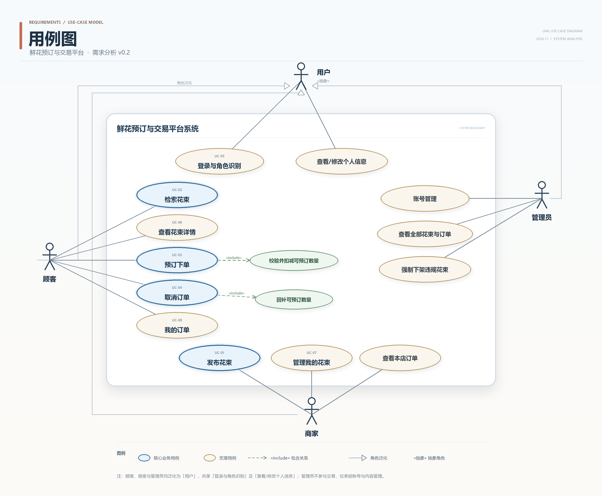

# UC-04 取消订单 —— 详细用例

> 实验一 · 需求分析 ｜ 主责人：林伟翔（UC-04）｜ 版本 v0.2 · 2026-11-09
> 对应需求：FR-07（主）、FR-06、FR-02、FR-08；NFR-02、NFR-03 ｜ 依据材料：实验一指导书 v1.7、第 2 次课任务单 v1.4

2026-11-07 口径同步：计价与数量按"束"；可预订数量表示剩余量，成功下单扣减 N、成功取消仅回补原订单 N 一次。日期等其他暂定规则未因此自动确认。详见[规则记录](../records/rules-uc02-uc06-2026-11-07.md)。

2026-11-09 修订（v0.2，对照 [UC-03 v0.2](uc-03-place-order.md) 的判重顺序口径）：把幂等判重从第 5 步提前到第 3 步——命中幂等键即直接返回首次取消成功结果（同一订单号与取消时间），不再校验归属与状态；重复取消不得改判为"订单已取消"式拒绝。可取消时限明确为"送达日期 0:00 前（暂定）"；A4 补充"状态不符"分支；新增 AC-UC04-09 固定"下架花束的有效订单仍可取消并回补"。取消流程示意代码见同目录 [uc-04-cancel-order-code.md](uc-04-cancel-order-code.md)（辅助材料，随实验二、三演化为正式设计）。

2026-11-09 第二次修订（依据 [Issue #4](https://github.com/Longqc666/243-25-project/issues/4) 的三条评审意见）：①补充 AC-UC04-10（回补失败整体回滚，订单与剩余量均保持原值、重试只生效一次）与 AC-UC04-11（可取消时限截止时刻的边界情境）；②第 6 节"已完成"一行标明与 FR-06 原文的口径差异；③定时限为"送达日期 0:00 前"并注明需 UC-03 同步；④Issue 正文补"负责人""所属实验""关联编号"三段，完成条件同步为 9 条。

## 0 完整用例图

## 1 用例基本信息

| 字段         | 内容                                                         |
| ------------ | ------------------------------------------------------------ |
| 编号         | UC-04                                                        |
| 名称         | 取消订单                                                     |
| 目标         | 顾客把本人的"有效"订单置为"已取消"，系统回补该花束的可预订数量并保留历史记录。 |
| 主要参与者   | 顾客                                                         |
| 次要参与者   | 商家（间接受影响：回补后本店花束可预订数量增加，本店订单中该订单状态变为"已取消"）；其他顾客（可预订到释放的数量，S-05） |
| 触发条件     | 顾客在"我的订单"中选定本人"有效"订单，点击"取消订单"并确认。 |
| 前置条件     | C1 顾客已使用预置的顾客账号登录，系统已知其身份与角色（B-02、FR-08）。 C2 顾客已进入"我的订单"，页面展示本人订单的订单号、状态与"取消订单"入口。 C3 说明：订单"是否归属本人""是否仍为有效""是否在可取消时限内"**均不列为前置条件**——它们在提交瞬间可能已被改变（重复取消、并发再预订、超时），必须在流程第 4—5 步重新校验，否则重复取消与越权情形无法表达。 |
| 成功后置条件 | P1 订单状态置为"已取消"，记录取消时间与操作者；订单内容（花束、数量、单价快照、金额、送达日期、下单时间）不变，记录不删除（B-06）。 P2 该花束可预订数量增加 N（N 为订单数量），回补写入 UC-01/UC-07 维护的可预订数量（B-06）。 P3 订单仍在"我的订单"（UC-08）中可见且状态显示"已取消"，不计入有效订单（Q-06）；释放的数量可被其他顾客预订（S-05）。 |
| 失败后保证   | F1 订单状态保持不变，不产生新的状态变更。 F2 该花束可预订数量保持不变（不回补）。 F3 已有有效订单及其占用的数量不受影响。 F4 顾客收到可定位的失败原因；越权拒绝的响应中不含订单原属顾客的姓名、联系方式等信息（NFR-03）。 |

## 2 正常流程

| 步骤 | 参与者动作                                               | 系统响应与校验点                                             |
| ---- | -------------------------------------------------------- | ------------------------------------------------------------ |
| 1    | 在"我的订单"中选定一笔"有效"订单，点击"取消订单"并确认。 | 接收请求，以本次请求的幂等键标识该次取消。                   |
| 2    | —                                                        | 校验登录状态与角色为顾客；不通过转 A1。                      |
| 3    | —                                                        | 按幂等键判重：命中则直接返回首次成功结果（同一订单号与取消时间），**不再校验归属与状态**，不重复回补库存，转 A3。 |
| 4    | —                                                        | 校验订单存在且归属当前登录顾客；不通过转 A2。                |
| 5    | —                                                        | 校验订单当前状态为"有效"且在可取消时限（暂定"送达日期 0:00 前"）内；不通过转 A3（已取消）或 A4（超时限或状态不符）。 |
| 6    | —                                                        | 以"订单状态 = 有效"为条件原子地把订单置为"已取消"，记录取消时间与操作者；若条件更新未命中（已被并发取消），转 A5。 |
| 7    | —                                                        | 在同一事务内回补该花束可预订数量 +N（B-06：仅回补原订单 N 一次），并写入订单状态变更历史（只增不删）；回补失败则整体回滚，转 A6。 |
| 8    | —                                                        | 显示取消成功摘要：订单号、花束、数量、取消时间，并提示"历史记录保留，可在我的订单查看"。 |
| 9    | 点击"查看我的订单"。                                     | 进入 UC-08，该订单状态显示为"已取消"。                       |

## 3 异常与备选流程

### A1 未登录或角色不符（分支点：第 2 步）

- 触发：会话已失效、未登录；或已登录但以商家、管理员账号访问取消入口。
- 处理：未登录或会话失效时，引导至登录页并提示"请使用顾客账号登录"，登录成功后返回"我的订单"；已登录但角色不符时，直接拒绝并提示"仅顾客本人可取消"，不引导重新登录。
- 结束：本次请求结束，订单状态与可预订数量均不变（F1、F2）。
- 依据：FR-08、B-06、Q-05（商家不能代顾客取消）。

### A2 订单不存在或非本人订单（分支点：第 4 步）

- 触发：订单号有误；或顾客 A 篡改订单号尝试取消顾客 B 的订单（S-06）。
- 处理：拒绝并统一提示"订单不存在或无权操作"，不区分两种情况，避免通过差异提示枚举他人订单号；响应中不含 B 的姓名、联系方式等信息（NFR-03）。
- 结束：订单与库存均不变（F1—F3）。
- 依据：B-06、NFR-03、S-06。

### A3 重复取消（分支点：第 3、5 步）

- 触发：同一幂等键的取消请求再次到达（重复点击、断网后重试、旧请求重放，S-05）；或顾客以新请求取消一笔已取消的订单。
- 处理：幂等键命中时，直接返回首次成功结果（同一订单号与取消时间），不重复回补库存，不生成第二条状态变更记录；无幂等键命中的新请求遇到"已取消"订单时，提示"订单已取消"。
- **关键情形**：首次取消已成功、订单状态已变为"已取消"，同一请求重试仍返回首次成功结果，**不得改判为"订单已取消"式拒绝**；判重先于状态校验执行（与 UC-03 v0.2 第 3 步同口径）。
- 结束：以首次请求的结果结束；该花束可预订数量只回补 1 次（NFR-02）。
- 依据：FR-07、NFR-02、S-05。

### A4 超出可取消时限或状态不符（分支点：第 5 步）

- 触发：可取消时限（暂定"送达日期 0:00 前"）已过；或订单状态既非"有效"也非"已取消"（为后续扩展保留）；后续若引入"已完成"状态，已完结订单同样落入本分支（Q-10）。
- 处理：拒绝并提示"该订单当前状态或时间不可取消"，说明原因。
- 结束：订单状态与库存不变。
- 依据：本用例第 6 节的暂定可取消时限；订单状态集合见 Q-10。

### A5 并发重复取消（分支点：第 6 步）

- 触发：同一顾客在两个终端同时取消同一订单，或第 5 步校验通过后、状态更新前另一请求已完成取消。
- 处理：以"状态 = 有效"为条件更新，仅 1 个请求命中；未命中方按幂等口径返回首次成功结果。
- 结束：库存只回补 1 次，状态变更历史只新增 1 条。
- 依据：NFR-02；NFR-01（并发一致性）类比适用。
- 说明：本条只约定业务结果，不规定数据库锁或具体实现方式（课程明确本次不要求设计锁）。

### A6 回补失败或系统异常（分支点：第 7 步）

- 触发：状态更新成功后、库存回补前发生异常或断网。
- 处理：同一事务内整体回滚——订单状态与库存要么同时变更、要么都不变更；顾客重试时按幂等键判定，不产生中间态。
- 结束：不出现"已取消但未回补"或"已回补但未取消"的订单。
- 依据：B-05（剩余量非负，取消仅回补一次）；NFR-01（并发一致性）类比适用。

## 4 验收条件

| 编号       | 给定                                                         | 当                                        | 则                                                           |
| ---------- | ------------------------------------------------------------ | ----------------------------------------- | ------------------------------------------------------------ |
| AC-UC04-01 | 顾客 C 有一笔"有效"订单 O1（花束 A、2 束、单价快照 199、金额 398），A 当前可预订数量 3。 | C 取消 O1 并确认。                        | O1 状态变为"已取消"并记录取消时间；A 的可预订数量变为 5；O1 仍出现在"我的订单"中（FR-07、B-06）。 |
| AC-UC04-02 | O1 已取消，A 的可预订数量为 5。                              | 同一取消请求（同一幂等键）重复到达 3 次。 | 三次均返回首次取消成功结果（同一订单号与取消时间），**不出现"订单已取消"式改判拒绝**；A 的可预订数量保持 5，不重复回补（NFR-02、S-05）。 |
| AC-UC04-03 | 顾客 B 登录后把请求中的订单号改为 C 的 O1 并提交取消。       | 请求到达系统。                            | 拒绝并提示"订单不存在或无权操作"；响应不含 C 的姓名、联系方式；O1 状态与 A 的库存均不变（NFR-03、B-06）。 |
| AC-UC04-04 | O1 已取消且 A 的可预订数量为 5。                             | 顾客 C1 预订 A 共 2 束。                  | 生成 1 条新"有效"订单，A 的可预订数量变为 3；O1 保持"已取消"且历史记录不变（S-05、B-05）。 |
| AC-UC04-05 | 用户未登录。                                                 | 直接携带订单号发起取消。                  | 引导至登录页；登录后返回"我的订单"；期间订单与库存不变（FR-08）。 |
| AC-UC04-06 | 商家账号登录，本店花束 A 对应订单 O1。                       | 商家对 O1 发起取消。                      | 拒绝并提示"仅顾客本人可取消"；O1 状态与库存不变（B-06、Q-05）。 |
| AC-UC04-07 | 订单 O2 状态为"已取消"。                                     | C 在"我的订单"按状态筛选。                | O2 显示"已取消"，含订单号、花束、数量、金额、送达日期、下单时间与取消时间，记录完整可查（B-06、Q-06、FR-06）。 |
| AC-UC04-08 | 同一订单 O1，C 在两个终端同时发起取消。                      | 两请求并发到达，重复 10 轮。              | 每轮仅 1 次取消生效、仅回补 1 次；A 的可预订数量终值一致；状态变更历史仅 1 条（NFR-02；NFR-01 类比）。 |
| AC-UC04-09 | 花束 A 已下架，顾客 C 的订单 O1 状态为"有效"，A 的可预订数量 3。 | C 取消 O1。                               | 取消成功：O1 置为"已取消"，A 的可预订数量变为 5；A 仍不出现在顾客检索结果中，但 O1 历史记录可查（FR-02、B-06）。 |
| AC-UC04-10 | 顾客 C 有一笔"有效"订单 O1（花束 A、2 束），A 的可预订数量 3；取消时模拟库存回补步骤发生异常（服务不可用）。 | C 提交取消请求。                          | 请求返回失败；**O1 仍为"有效"、取消时间为空，A 的可预订数量保持 3**（状态与库存均未变更，A6）；异常恢复后重试成功，且只回补 1 次、只产生 1 条状态变更记录（NFR-02）。 |
| AC-UC04-11 | 今天为 D。订单 O1 送达日期为 D+1，订单 O2 送达日期为 D，两者均为"有效"。 | C 在 D 当天分别取消 O1 与 O2。            | O1 取消成功，A 的可预订数量 +N；O2 被拒绝并提示"该订单已超出可取消时间"，O2 状态与库存均不变（A4、第 6 节暂定时限）。 |

## 5 关联需求与相邻用例

- **主关联**：FR-07（取消订单）。
- **相关需求**：FR-08（角色与登录）、FR-06（我的订单，取消入口与状态展示）、FR-02（可预订数量维护，回补落点）、NFR-02（幂等）、NFR-03（越权与信息泄露防护）；NFR-01（并发一致性）经 A5、AC-UC04-08 类比适用；约定 B-05（剩余量非负，下单扣减、取消仅回补一次）、B-06（仅本人可取消、取消后库存回补、历史保留）。
- **相邻用例**：上游为 UC-08 我的订单（本用例的入口）与 UC-03 预订下单（产生可取消的订单）；下游为 UC-01/UC-07（回补的数量写回商家维护的可预订数量），释放的库存回到 UC-02 检索与 UC-03 下单的可预订池。**下单与取消各自独立成用例**，不用包含/扩展连线表达先后顺序。

## 6 待确认与暂定规则

| 规则                       | 当前处理                                                     | 依据                                                         | 对本用例的影响                                               |
| -------------------------- | ------------------------------------------------------------ | ------------------------------------------------------------ | ------------------------------------------------------------ |
| 下单后可取消的时限         | **本期定为：订单状态为"有效"且送达日期 0:00 前（送达日开始前）可随时取消**。Issue #4 讨论中已比较"下单后 24 小时"方案，因长周期订单会在 24 小时后过早锁死而未采纳；是否另设更长提前量留作后续扩展 | B-06；Issue #4 评审意见                                      | UC-03 第 6 节现为"由 UC-04 统一定义"，需同步为本条口径，否则互评会判为规则冲突 |
| 商家能否取消（拒单）       | 已约定：不能，仅顾客本人可取消                               | Q-05、B-06                                                   | 商家发起走 A1，另设 AC-UC04-06 验证                          |
| 已取消订单是否计入有效订单 | 暂定：保留记录但不计入有效订单                               | Q-06                                                         | "我的订单"筛选与商家端订单统计口径                           |
| 订单状态集合是否含"已完成" | 暂定本期仅"有效/已取消"两态                                  | Q-10；FR-06 原文含"已完成"，与本行暂定口径不一致，待组内统一 | 若后续引入"已完成"，A4 与第 4 节需补充"已完结不可取消"分支；AC-UC04-07 的状态筛选须与最终状态集合一致 |
| 取消是否需商家确认         | 暂定不需要，取消即时生效                                     | B-06                                                         | 流程第 6 步直接生效                                          |

## 7 本人负责模块说明（报告第 2 节素材）

- **名称**：取消订单（订单状态变更与库存回补）。
- **功能范围**：从顾客在"我的订单"发起取消，到订单置为"已取消"与可预订数量回补、历史保留；不含下单（UC-03）与订单查看（UC-08）本身，不含支付、退款、物流与履约（排除范围）。
- **输入**：顾客身份与会话、订单号、确认操作、幂等键。
- **输出**：订单状态"已取消"及取消时间、该花束可预订数量 +N、订单状态变更历史记录、成功或可定位的失败提示。
- **与其他模块的关系**：入口依赖 UC-08 提供的订单列表与详情；被取消的订单由 UC-03 生成，并与 UC-03 共用订单状态集合、"判重先于状态校验"与"可取消时限"口径；回补的数量写回 UC-01/UC-07 维护的可预订数量，供 UC-02 检索与 UC-03 下单使用；越权判定依赖 FR-08 的登录与角色。
- **本人具体工作**：起草 UC-04 的全部字段与 6 个异常/备选场景；补写 AC-UC04-01～AC-UC04-11；按 UC-03 v0.2 口径把幂等判重提前到第 3 步；按 Issue #4 评审意见补回补失败回滚与时限边界两条验收、标明 FR-06"已完成"口径差异；核对 FR-07、FR-08、NFR-02、NFR-03 与本用例的一致性；与 UC-03 负责人统一定义"下单后可取消时限"；在互评中记录意见与处理结果。

## 8 个人贡献与反思（报告第 7 节素材）

- **贡献**：UC-04 的详细描述与验收条件起草，三轮修订（补越权与重复取消场景；把"订单归属"从前置条件改为流程内校验；按 UC-03 v0.2 口径把幂等判重提前到状态校验之前），以及与 UC-03 的时限口径核对。
- **反思一**：初稿把"订单属于本人"写成前置条件。组内走读时发现，这样一来"顾客 A 篡改订单号取消他人订单"就无处表达，与 NFR-03、S-06 冲突。改为在流程第 4 步校验归属，并新增 A2 与 AC-UC04-03。
- **反思二**：初稿把"先改状态、再回补库存"写成两个独立步骤。互评时被指出"状态改了、库存没回补"会产生不一致，与 B-05、NFR-01 冲突。改为同一事务内变更，新增 A6 并在失败后保证中明确 F2。
- **反思三**：第一次漏了旧取消请求再次到达的情形。对照任务单 S-05"旧取消请求再次到达时会不会重复回补"后，补了 A3、A5 与 AC-UC04-02、AC-UC04-08，并对应 NFR-02。
- **反思四**：口径核对发现判重放在状态校验之后——首次取消已把订单置为"已取消"时，同一请求的重试会先撞上状态判断、被改判为"订单已取消"式拒绝，而不是首次成功结果。对照 UC-03 v0.2 反思四"异常分支的顺序本身也是需求"，已把幂等判重提前到第 3 步，并以 AC-UC04-02 把"重试返回首次取消成功结果"固定下来。走读时应逐条模拟"同一请求在不同时刻再次到达"。
- **反思五**：可取消时限初稿和 UC-03 互相写"以对方为准"，等于谁都没定，互评时会被判成规则冲突。这说明**跨用例的共享规则必须有一方给出具体值、另一方引用该值**，不能只写"由对方定义"。本次已定为"送达日期 0:00 前"，并注明 UC-03 需同步；同时补了截止时刻的边界验收（AC-UC04-11），避免规则只停留在文字上。
