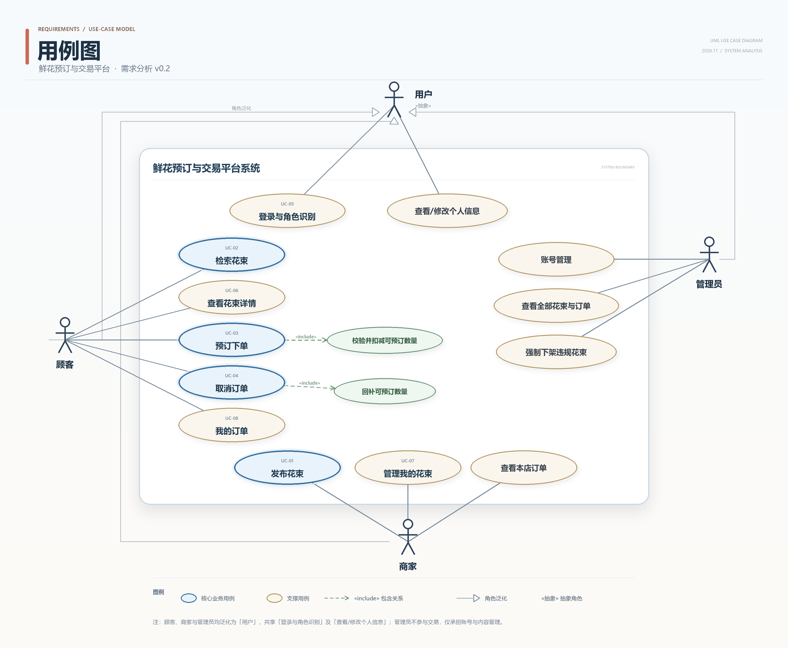

# UC-07 管理我的花束 —— 详细用例

> 实验一 · 需求分析 ｜ 主责人：庞华杰（UC-07）｜ 版本 v0.1 · 2026-11-06
> 对应需求：FR-02（主）、FR-08；约定 B-03、B-05、B-08；待确认 Q-01、Q-07、Q-12 ｜ 依据材料：实验一指导书 v1.7、第 2 次课任务单 v1.4
> 相邻用例：UC-01 发布花束（数据来源）、UC-02 检索花束 / UC-06 查看花束详情（可见性）、UC-03 预订下单（占用库存）、UC-04 取消订单（回补库存）

2026-11-07 规则同步：按小组已同意的 B-05 修正数量含义及对应验收；本次未替代原作者的组内走读或个人反思。详见[规则记录](../records/rules-uc02-uc06-2026-11-07.md)。

## 0 完整用例图

## 1 用例基本信息

| 字段 | 内容 |
|---|---|
| 编号 | UC-07 |
| 名称 | 管理我的花束 |
| 目标 | 商家查看本人发布的花束，并通过编辑、调整可预订数量、上架或下架，维持花束信息的准确与可售状态。 |
| 主要参与者 | 商家 |
| 次要参与者 | 顾客（间接受影响：上架/下架决定其能否检索到该花束）；平台管理员（可强制下架违规花束，不在本用例内）。 |
| 触发条件 | 商家进入"我的花束"，对某条花束执行编辑、调整数量、上架或下架。 |
| 前置条件 | C1 商家已使用预置商家账号登录，角色为"商家"（B-02、B-03、FR-08）。 C2 该商家至少发布过一条花束；若没有，列表展示空态与"发布花束"入口。 C3 系统可正常访问数据库与图片存储。 C4 说明：**"花束当前是否已上架""数量是否仍大于 0"不列为前置条件**——它们可能被商家本人或其他操作改变，必须在流程第 5 步按当前状态重新校验。 |
| 成功后置条件 | P1 列表按更新时间倒序展示当前商家的全部花束（含"已下架（待上架）""已上架""已下架"），不出现他人花束。 P2 编辑成功：花束字段更新；已上架花束的顾客端详情同步；改价不影响历史订单的单价快照（B-08）。 P3 调整数量成功：剩余可预订数量更新为新的非负整数，不与有效订单占用数比较，已有订单保持不变（B-05）。 P4 上架成功：状态变为"已上架"，花束进入顾客检索范围（FR-03）。 P5 下架成功：状态变为"已下架"，顾客检索不到；已产生的有效订单仍可查看与取消，取消回补的数量写回本花束（FR-07）。 |
| 失败后保证 | F1 目标花束的字段、可预订数量与状态均保持不变。 F2 不生成订单，不改变任何库存占用。 F3 拒绝越权操作时，响应中不含他人花束名称、价格、库存等信息。 F4 商家收到可定位的失败原因（字段、数量或状态哪一项不满足）。 |

## 2 正常流程

| 步骤 | 参与者动作 | 系统响应与校验点 |
|---|---|---|
| 1 | 在导航中进入"我的花束"。 | 校验登录状态与角色为"商家"；不通过转 A1。 |
| 2 | — | 查询当前商家发布的全部花束，按更新时间倒序展示花名、缩略图、单价与单位、可预订数量、状态与可用操作。 |
| 3 | 按状态筛选（全部/已上架/未上架），或输入花名关键字查找。 | 仅在当前商家本人的花束范围内筛选与匹配，返回结果数量。 |
| 4 | 选中一条花束，选择操作：编辑、调整可预订数量、上架或下架。 | 展示对应表单或确认框；表单回显该花束的当前内容。 |
| 5 | — | 校验该花束归属当前商家，并校验当前状态是否允许该操作；不通过转 A2（非本人）、A3（不存在）或 A6（状态不允许）。 |
| 6 | 提交修改后的字段、新的可预订数量，或确认上架/下架。 | 接收请求，以本次请求的幂等键标识该次操作，供第 8 步判重。 |
| 7 | — | 按第 4 节规则校验字段格式、文本长度、图片、单价与数量约束；不通过转 A4（字段）或 A5（数量）。 |
| 8 | — | 按幂等键判重；以当前版本号为条件在同一事务内更新记录（编辑/改量）或状态（上下架），写入更新时间；版本未命中转 A7，写入失败转 A9。 |
| 9 | — | 提示操作成功，刷新列表并显示最新字段、数量与状态；若修改了单价，提示"新价格仅对之后的新订单生效"。 |
| 10 | — | 用例结束。本用例可由商家设置新的剩余量，不生成或取消订单；订单引起的扣减与回补分别由 UC-03、UC-04 执行。 |

## 3 子流程

| 编号 | 子流程 | 要点 |
|---|---|---|
| 5A | 编辑花束 | 表单回显花名、单价、单位、可预订数量、花语/适用场景、分类、图片与选填项；校验规则与 UC-01 一致；保存后列表更新，已上架时顾客端详情同步；改价不改变历史订单金额（B-08） |
| 5B | 调整可预订数量 | 只改一个字段；新值表示剩余量，须为不小于 0 的整数，不以当前有效订单占用数作为下限，已有订单不变（B-05）；提交时携带读取到的旧剩余量作为条件，若顾客下单或取消已改变剩余量，本次改量不生效并提示刷新，避免用旧值覆盖订单结果（NFR-01）；保存后列表与详情显示新值；若新值为 0 且当前"已上架"，暂定自动下架并提示（Q-12，待确认） |
| 5C | 上架 | 仅"已下架（待上架）"或"已下架"可上架；上架前校验可预订数量大于 0；确认后状态变为"已上架"，顾客可检索到 |
| 5D | 下架 | 仅"已上架"可下架；确认框提示"下架不影响已产生的有效订单"；确认后状态变为"已下架"，顾客检索不到 |
| 5E | 查看与筛选 | 只读操作，不修改任何数据；筛选与关键字只作用于当前商家本人的花束，不返回他人数据 |

## 4 字段与校验

| 字段 | 是否可编辑 | 类型/取值 | 校验规则 |
|---|---|---|---|
| 花名 | 是 | 字符串 | 去首尾空白后非空；长度上限与 UC-01 一致 |
| 单价 | 是 | 十进制（保留 2 位小数） | 大于 0，不超过上限；改价不影响历史订单快照（B-08） |
| 单位 | 否（固定展示） | 束 | 单价按元/束，数量按束，与UC-01一致（B-05） |
| 可预订数量 | 是 | 整数（束） | 表示剩余量，≥ 0，不与有效订单占用数比较；上架前须 > 0（B-05） |
| 花语/适用场景 | 是 | 文本 | 非空；长度上限与 UC-01 一致 |
| 分类 | 是 | 枚举 | 须属于预置分类 |
| 图片 | 是 | jpg/png | 至少 1 张，单张 ≤ 2 MB；张数上限待确认（Q-01） |
| 颜色、节日档期 | 是（可选） | 枚举或文本 | 若填写须属于预置选项 |
| 上下架状态 | 否（只能通过上架/下架操作变更） | 已下架（待上架）/已上架/已下架 | 初始为"已下架（待上架）"；转换见第 3、5 节 |
| 商家标识 | 否（系统维护） | 取自当前登录态 | 不接受前端传入，用于归属与越权判定 |

## 5 异常与备选流程

### A1 未登录或角色不符（分支点：第 1 步）

- 触发：会话失效、未登录，或以顾客、管理员账号访问"我的花束"。
- 处理：引导至登录页并提示"请使用商家账号登录"；顾客端不展示该入口（FR-08）。
- 结束：不返回任何花束数据（F1）。
- 依据：FR-08、B-02、B-03。

### A2 非本人花束（分支点：第 5 步）

- 触发：商家 A 篡改花束标识，尝试编辑、改量或上下架商家 B 的花束。
- 处理：拒绝并统一提示"花束不存在或无权操作"，不区分"不存在"与"非本人"，避免通过差异提示枚举他人花束；响应不含 B 的花束信息。
- 结束：B 的花束字段、数量与状态均不变（F1、F3）。
- 依据：FR-02、B-03。

### A3 花束不存在或已删除（分支点：第 5 步）

- 触发：花束标识有误，或该记录已被删除。
- 处理：提示"花束不存在或已删除"，刷新列表；不产生写入。
- 结束：不改变任何记录（F1）。
- 依据：FR-02。

### A4 编辑字段校验失败（分支点：第 7 步）

- 触发：必填项缺失、文本超长、单价 ≤ 0 或超上限、单位不是固定值“束”或分类不在枚举内、图片格式或大小不符合约定。
- 处理：逐项高亮并提示具体原因，阻止保存；表单内容保留。
- 结束：原记录与状态不变（F1、F4）。
- 依据：FR-02、FR-01、Q-01。

### A5 可预订数量非法（分支点：第 7 步）

- 触发：数量为小数、负数或非整数。已有订单占用3束而将剩余量改为2束不属于非法数量。
- 处理：提示"剩余可预订数量必须为不小于 0 的整数"；不保存。
- 结束：数量保持原值（F1）。
- 依据：B-05、FR-02。

### A6 当前状态不允许该操作（分支点：第 5 步）

- 触发：对"已上架"花束再次点击"上架"；对"已下架（待上架）"点击"下架"；或在可预订数量为 0 时点击"上架"。
- 处理：重复操作按幂等返回当前状态；数量为 0 时拒绝上架并提示"请先补充可预订数量"。
- 结束：状态保持不变，不产生额外写入（F1）。
- 依据：FR-02、B-05。

### A7 并发修改冲突（分支点：第 8 步）

- 触发：两位操作者或两个标签页同时修改同一花束，后提交者的版本号已过期。
- 处理：条件更新未命中即拒绝，提示"内容已被修改，请刷新后重试"，不覆盖他人修改。
- 结束：后提交者的修改不生效，先提交者的结果保留（F1）。
- 依据：FR-02、NFR-02（重复与并发只产生一次业务效果）。
- 说明：本条只约定业务结果，不规定数据库锁或具体实现方式（课程明确本次不要求设计锁）。

### A8 重复提交（分支点：第 8 步）

- 触发：商家双击保存，或断网后重试，同一幂等键的请求到达 2 次以上。
- 处理：返回首次结果，不重复更新字段或状态。
- 结束：只产生 1 次业务效果（NFR-02）。
- 依据：NFR-02。

### A9 写入失败或图片上传中断（分支点：第 8 步）

- 触发：图片上传中途断网、数据库写入失败或事务提交失败。
- 处理：整个操作回滚，字段、数量与状态均不变；提示"保存失败，请重试"。
- 结束：不留下半条更新（F1）。
- 依据：FR-02。

### A10 编辑过程中花束被下架或售罄（分支点：第 6—9 步）

- 触发：商家打开编辑表单期间，该花束被另一终端下架，或最后库存被顾客订走。
- 处理：编辑仍可保存；保存后列表与详情提示当前最新状态，不因编辑自动上架。
- 结束：字段更新成功，状态保持最新值（F1 不适用，因操作已成功）。
- 依据：FR-02、FR-03。

### A11 改量与下单/取消并发（分支点：第 8 步）

- 触发：商家提交新的剩余量时，顾客正对同一花束下单或取消，双方基于同一旧剩余量。
- 处理：商家改量以"提交时读取的旧剩余量"为条件更新；下单以"剩余量 ≥ 本单数量"为条件扣减；取消以"订单仍为有效"为条件，按取消当时的剩余量加 N 且仅一次。任一方条件未命中时不覆盖对方结果：商家提示"剩余量已变化，请刷新后重试"，下单提示"库存不足"，取消按原结果返回。
- 结束：两请求互斥生效，剩余量终值不小于 0；不出现旧值覆盖、扣成负数或重复回补（B-05、NFR-01、NFR-02）。
- 依据：B-05、NFR-01、NFR-02。
- 说明：本条只约定业务结果，不规定数据库锁或具体实现方式（课程明确本次不要求设计锁）。

## 6 验收条件

以下使用虚构商品情境，作为需求走读与后续测试依据，当前均未执行。

| 编号 | 给定 | 当 | 则 |
|---|---|---|---|
| AC-UC07-01 | 商家 A 有 3 条花束（2 条已上架、1 条待上架），商家 B 有 1 条已上架花束。 | A 进入"我的花束"并选择"已上架"筛选。 | 只显示 A 的 2 条已上架花束；不出现 B 的任何花束。 |
| AC-UC07-02 | A 的花束 X 已上架、单价 99 元，已有 1 笔历史订单 O1（金额按 99 元快照）。 | A 把 X 的花名改为"向日葵思慕"、单价改为 109 元并保存。 | 列表与顾客端详情显示新花名与 109 元；O1 的金额仍为 99 元，不随改价变化（B-08）。 |
| AC-UC07-03 | X 的有效订单合计占用 2 束，当前可预订数量为 10。 | A 将可预订数量改为 3 并保存。 | 保存成功；列表与详情显示 3；有效订单不受影响（B-05）。 |
| AC-UC07-04 | X 的有效订单合计占用 3 束，当前剩余可预订数量为 3。 | A 将剩余可预订数量改为 2 并提交。 | 保存成功，剩余量为2；既有订单仍占用3且不受影响，不把占用数当作剩余量下限（B-05）。 |
| AC-UC07-05 | X 当前可预订数量为 3。 | A 分别填 1.5、-1、abc 后提交。 | 均提示须为不小于 0 的整数；均不保存，数量仍为 3。 |
| AC-UC07-06 | X 可预订数量为 0，状态"已下架（待上架）"。 | A 点击"上架"。 | 拒绝并提示"请先补充可预订数量"；状态仍为"已下架（待上架）"。 |
| AC-UC07-07 | X 可预订数量为 10，状态"已下架（待上架）"。 | A 上架 X，顾客按花名检索；随后 A 下架 X，顾客再次检索。 | 上架后可检索到并可进入详情；下架后检索不到；X 的历史有效订单仍可查看与取消，取消后数量回补。 |
| AC-UC07-08 | 商家 A、B 均已登录，X 属于 B。 | A 构造请求，尝试编辑 X 的花名或下架 X。 | 拒绝并提示"花束不存在或无权操作"；X 的字段、数量与状态均不变；响应不含 X 的信息。 |
| AC-UC07-09 | X 当前"已上架"。 | A 连续点击"上架"两次；另一轮中对"已下架"的 X 连续点击"下架"两次。 | 状态分别保持"已上架""已下架"；不产生重复记录或额外的状态变更。 |
| AC-UC07-10 | X 当前可预订数量为 5；A 在两个终端同时打开编辑页。 | 终端 1 保存数量 4 后，终端 2 基于旧版本保存数量 3。 | 终端 2 收到"内容已被修改，请刷新后重试"；数量保持 4，不被 3 覆盖。 |
| AC-UC07-11 | X 已上架、可预订数量为 2。 | A 将可预订数量改为 0 并保存。 | 暂定保存成功并自动下架，列表显示"已下架"并提示原因（Q-12，待确认）。 |
| AC-UC07-12 | 用户未登录，或使用顾客账号。 | 直接访问"我的花束"。 | 引导至登录页或拒绝访问；期间不返回任何花束数据（FR-08）。 |
| AC-UC07-13 | X 已上架、剩余量为 10；顾客 C 同时提交 3 束订单。 | 商家 A 提交改量 10→3，与 C 的下单并发到达，重复 10 轮。 | 两请求互斥生效：若下单先完成，剩余量先变 7，A 的改量因旧值不符被拒绝并提示刷新；若改量先完成，剩余量变 3，下单扣 3 后为 0。每轮终值不小于 0，不出现负数、旧值覆盖或重复扣减（B-05、NFR-01）。 |

## 7 关联需求与相邻用例

- **主关联**：FR-02（管理我的花束）。
- **相关需求**：FR-01（发布，字段校验基准）、FR-03/FR-04（检索与详情，受上下架影响）、FR-05（下单占用可预订数量）、FR-07（取消回补可预订数量）、FR-08（登录与角色）、NFR-02（重复提交只产生一次效果）；约定 B-03（由商家发布）、B-05（剩余量非负，商家改量不改变已有订单）、B-08（单价快照）。
- **相邻用例**：上游为 UC-01 发布花束；本用例维护的数据供 UC-02 检索、UC-06 详情、UC-03 下单使用；UC-04 取消后回补的数量写回本用例维护的可预订数量。**本用例不生成订单、不扣减库存**，也不负责发布时的首次录入。

## 8 待确认与暂定规则

| 规则 | 当前处理 | 依据 | 对本用例的影响 |
|---|---|---|---|
| 可预订数量改为 0 时是否自动下架 | 暂定自动下架并提示 | Q-12（本文件登记） | 影响 5B、AC-UC07-11；若改为禁止改 0，需新增校验与错误提示 |
| 编辑已上架花束是否需要重新审核或自动下架 | 未定；暂定不审核、不自动下架 | FR-02 | 影响 5A 的后置条件与验收；若需审核，编辑流程要增加待审状态 |
| 管理员强制下架后能否由商家自行重新上架 | 暂定不能，需管理员解除 | Q-07 | 影响 A6 与 5C 的状态判断 |
| 是否支持批量上下架/批量改量 | 暂定不支持，一次一条 | FR-02 | 影响主流程与幂等粒度 |
| 并发修改使用版本号还是更新时间 | 暂定版本号 | FR-02 | 影响 A7、A11 与 AC-UC07-10、AC-UC07-13 的判定；不规定数据库实现 |
| 列表是否分页、默认排序 | 暂定按更新时间倒序，暂不分页 | FR-02 | 影响第 2 步展示与大数据量下的验收 |
| 图片张数上限、编辑时能否删空 | 未定；暂定至少保留 1 张 | Q-01 | 影响 A4 与 5A |

## 9 本人负责模块说明（报告第 2 节素材）

- **名称**：管理我的花束（花束信息维护、可预订数量调整与上下架）。
- **功能范围**：从商家进入"我的花束"，到查看、筛选、编辑、调整可预订数量、上架或下架；不含首次发布（UC-01），不含检索、下单与取消，不含支付、退款、物流与评价（排除范围）。
- **输入**：商家身份与会话、目标花束标识、修改后的字段、新的可预订数量、目标上下架状态、幂等键。
- **输出**：更新后的花束记录与状态、可预订数量、列表展示、可定位的成功或失败提示。
- **与其他模块的关系**：消费 UC-01 生成的记录；向 UC-02/UC-06 提供可见性与商品信息；向 UC-03 提供可预订数量作为库存基线；接收 UC-04 取消后的数量回补。本模块本身不生成订单、不扣减库存。
- **本人具体工作**：把原 Issue #1 第六节的 FR-02 子流程独立为 UC-07；起草主流程、4 个子流程与 A1—A11 异常场景；补充 AC-UC07-01—AC-UC07-13；统一"已下架（待上架）/已上架/已下架"状态名称与 B-05、B-08 口径；登记 Q-12；按 Issue 评审意见补充改量与下单/取消并发约束。

## 10 个人贡献与反思（报告第 7 节素材）

- **贡献**：UC-07 详细用例与验收条件起草；UC-01/UC-07 的职责拆分；在 Issue #5 中维护任务范围与完成条件；把管理流程从"发布花束"中独立出来并与 FR-02 对齐。
- **反思一**：初稿把"编辑、改量、上下架"塞进 UC-01，导致同一个用例对应 FR-01 与 FR-02 两条需求，验收条件无法一一对应。拆分后，UC-01 只到"待上架"，UC-07 承接后续管理，主流程更清晰。
- **反思二**：初稿把"花束属于本人"写成前置条件。在 Issue 文档评审中意识到，这样一来"商家 A 篡改标识操作 B 的花束"就无处表达。改为在第 5 步校验归属，并新增 A2 与 AC-UC07-08。
- **原反思三的后续修订说明（2026-11-07）**：原文按总容量理解数量，因而要求“不得低于已占用数量”。本次共同口径改为剩余量后，该限制不再适用；已同步 P3、5B、字段校验、A5 与 AC-UC07-04。原作者可在个人报告中据实际讨论补写反思；“改为0是否自动下架”仍按 Q-12 暂定。
- **并发约束的补充（2026-11-09）**：何奕佳在 Issue #5 指出，改量与下单抢库存未写并发约束。已在 5B 增加“旧剩余量为条件”的提交规则，并新增 A11、AC-UC07-13，与 B-05、NFR-01 对齐。

## 11 评审意见与处理（2026-11-07 至 2026-11-09）

| 来源 | 意见 | 处理 |
|---|---|---|
| 庞延新（Issue #1／#5 评论） | 单位与数量规则统一为“按束计量、数量表示剩余量”；#5 中“已有订单占用 3 束、剩余量改为 2 束”的情境应与最新验收一致 | 保留 2026-11-07 规则同步后的口径：5B 与 AC-UC07-04 均按剩余量判断，不再把已占用数当下限，已有订单不变 |
| 庞延新（Issue #5 评论） | #5 成果已提交，补提交链接并按实际更新完成清单 | 已在 Issue #5 正文补充成果链接与提交记录，完成条件按实际勾选；组内正式互评仍以 Issue 记录为准 |
| 何奕佳（Issue #5 评论） | 改数量与下单抢库存的并发未写；建议两边都以“剩余量条件更新”提交、互斥生效，否则可能扣成负数 | 在 5B 增加旧剩余量条件更新；新增 A11“改量与下单/取消并发”与 AC-UC07-13，引用 B-05、NFR-01 |

本次为 GitHub Issue 文档评审，未运行程序测试；新增验收条件均为“未执行”。

## 12 提交与自查清单

- [x] 用例基本字段齐全（编号、名称、目标、参与者、触发、前后置、失败后保证）
- [x] 主流程按"参与者动作—系统响应"逐步描述，并覆盖编辑、改量、上架、下架 4 个子流程
- [x] 异常/备选场景覆盖越权、状态冲突、并发冲突、重复提交与写入失败
- [x] 验收条件采用"给定—当—则"，覆盖正常流程与至少 3 个异常
- [x] 写明与 FR-02、FR-01、FR-03、FR-05、FR-07、B-05、B-08、Q-07、Q-12 的对应关系
- [x] 与 UC-01 的状态名称、字段校验口径一致
- [x] 评审意见处理结果（2026-11-07 至 2026-11-09，Issue #1／#5 评论）
- [x] 成果同步到仓库 `requirements/uc-07-manage-bouquets.md`

**关联 Issue**：[#5 管理我的花束](https://github.com/Longqc666/243-25-project/issues/5) ｜ **成果位置**：`requirements/uc-07-manage-bouquets.md`
