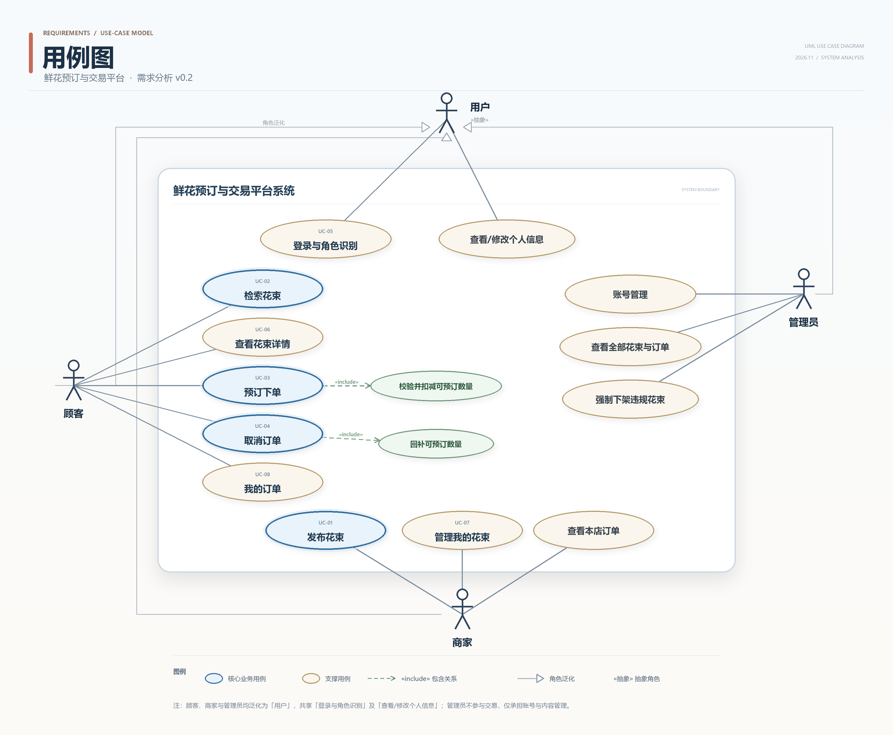

# UC-08 我的订单 —— 详细用例

> 实验一 · 需求分析 ｜ 主责人：何奕佳（UC-08）｜ 版本 v0.1 · 2026-11-07
> 对应需求：FR-06（主）、FR-05、FR-07、FR-08；NFR-03 ｜ 约定 B-06、Q-06、Q-10 ｜ 依据材料：实验一指导书 v1.7、第 2 次课任务单 v1.4、`scope.md` 待确认规则

## 0 完整用例图



## 1 用例基本信息

| 字段 | 内容 |
|---|---|
| 编号 | UC-08 |
| 名称 | 我的订单 |
| 目标 | 顾客查看本人订单列表与单条详情，按状态筛选，全过程不出现他人订单的任何数据。 |
| 主要参与者 | 顾客 |
| 次要参与者 | 商家（订单状态与剩余量的变化由 UC-03、UC-04 引起，本用例只读展示，不改变它们） |
| 触发条件 | 顾客点击"我的订单"入口；或在下单成功页点击"查看我的订单"。 |
| 前置条件 | C1 顾客已使用预置的顾客账号登录，系统已知其身份与角色（B-02、FR-08）。<br>C2 说明：**是否存在订单不列为前置条件**——没有订单是正常结果，按 A3 显示空列表，不应报错或当作异常。 |
| 成功后置条件 | P1 展示本人订单列表，每条含订单号、花束、数量、金额、送达日期、下单时间与当前状态（有效/已取消）。<br>P2 状态筛选生效，只返回所选状态的本人订单（FR-06、B-06）。<br>P3 可进入单条订单详情；状态为"有效"的订单提供"取消订单"入口，点击后进入 UC-04。 |
| 失败后保证 | F1 不返回他人订单的任何字段（订单内容、姓名、联系方式）。<br>F2 订单状态、取消时间与花束剩余数量均不因查看或筛选而改变（本用例只读）。<br>F3 读取失败时给出可重试提示，不把过期数据或他人数据当作结果展示。 |

## 2 正常流程

| 步骤 | 参与者动作 | 系统响应与校验点 |
|---|---|---|
| 1 | 点击"我的订单"。 | 按当前登录账号取本人订单，默认按下单时间倒序、每页 10 条（暂定，与 Q-09 的分页口径一并待确认）。 |
| 2 | — | 返回列表项：订单号、花束、数量、金额、送达日期、下单时间、状态；本人尚无订单时转 A3。 |
| 3 | 选择状态筛选（全部／有效／已取消）。 | 只返回该状态的本人订单；参数不合法转 A4（Q-10：本期只有"有效/已取消"两态）。 |
| 4 | 点击某条订单。 | 返回详情：列表字段之外，补充单价快照、履约方式；已取消订单补充取消时间（B-06 历史保留）。 |
| 5 | — | 状态为"有效"时显示"取消订单"入口；"已取消"为只读，不显示入口。查看期间状态若已被改变，转 A6。 |
| 6 | 点击"取消订单"。 | 进入 UC-04 取消订单；状态变更与库存回补由 UC-04 完成，本用例不做写入。 |
| 7 | 翻页或返回列表。 | 按请求页返回；页码越界转 A4。 |

## 3 异常与备选流程

### A1 未登录或角色不符（分支点：第 1 步）

- 触发：会话失效、未登录，或以商家账号访问顾客入口。
- 处理：引导至登录页并提示"请使用顾客账号登录"；登录成功后返回"我的订单"。
- 结束：期间不返回任何订单数据（F1、F3）。
- 依据：FR-08。

### A2 订单不存在或非本人订单（分支点：第 4、6 步）

- 触发：订单号已被删除、被伪造，或属于他人（例如手工改请求参数）。
- 处理：统一返回"订单不存在或无权查看"，不区分"不存在"与"无权"，不返回对方任何字段。
- 结束：订单状态与库存不变（F2）。
- 依据：FR-06、NFR-03（响应中不得含他人姓名、联系方式）、B-06。

### A3 本人无订单（分支点：第 2 步）

- 触发：顾客首次进入，或尚无任何订单。
- 处理：显示空列表与引导文案（如"还没有订单，去逛逛花束"），不显示错误。
- 结束：正常结束，不是异常；不影响任何数据。
- 依据：FR-06。

### A4 筛选或分页参数不合法（分支点：第 3、7 步）

- 触发：状态值不在"全部／有效／已取消"内；页码为 0、负数、非整数或超出总页数。
- 处理：忽略非法状态值并回到"全部"；页码越界回到第 1 页并提示"已为你显示第 1 页"。
- 结束：仍只返回本人订单，不因参数异常扩大范围。
- 依据：FR-06、Q-10。

### A5 订单数据读取失败（分支点：任一步）

- 触发：存储或服务不可用、超时。
- 处理：提示"订单加载失败，请重试"，提供重试按钮；重试仍从第 1 步开始。
- 结束：不展示不完整列表，不以缓存替代（F3）。
- 依据：FR-06。

### A6 查看期间订单状态已改变（分支点：第 5 步）

- 触发：顾客停留在列表或详情期间，该订单在另一终端被本人取消（或由 UC-04 取消）。
- 处理：刷新时展示最新状态；已在详情页时提示"该订单已取消"，同时移除"取消订单"入口。
- 结束：仅刷新展示，不改写状态；剩余数量的回补由 UC-04 负责，本用例不重复回补。
- 依据：FR-07、B-06、NFR-02（回补只发生一次）。

## 4 验收条件

| 编号 | 给定 | 当 | 则 |
|---|---|---|---|
| AC-UC08-01 | 顾客 C 有 2 笔订单（下单时间分别为 10:00、11:00）。 | C 打开"我的订单"。 | 只显示本人 2 笔，按时间倒序（11:00 在前），每条含订单号、花束、数量、金额、送达日期、下单时间与状态。 |
| AC-UC08-02 | C 有 1 笔"有效"、1 笔"已取消"。 | C 选择状态"已取消"。 | 只显示那 1 笔已取消订单，且含取消时间；有效订单不出现。 |
| AC-UC08-03 | 顾客 B 已登录，持有顾客 C 的订单号 O1。 | B 构造请求查询 O1 详情。 | 返回"订单不存在或无权查看"或空结果；响应中不含 C 的任何字段（NFR-03）。 |
| AC-UC08-04 | 顾客 C 尚未下过单。 | C 打开"我的订单"。 | 显示空列表与引导文案，不报错、不出现空白页。 |
| AC-UC08-05 | 用户未登录。 | 访问"我的订单"入口。 | 引导至登录页；登录后回到"我的订单"；期间不返回任何订单数据（FR-08）。 |
| AC-UC08-06 | C 有 23 笔订单，每页 10 条。 | C 翻到第 3 页，再请求第 9 页。 | 第 3 页显示 3 笔；第 9 页越界，提示后回到第 1 页；两次请求都只含本人订单。 |
| AC-UC08-07 | C 在列表页停留，期间在另一终端把订单 O1 取消。 | C 点击刷新。 | O1 显示"已取消"并出现取消时间；"取消订单"入口消失；花束剩余数量由 UC-04 回补且只回补一次。 |
| AC-UC08-08 | C 有 1 笔"有效"订单与 1 笔"已取消"订单。 | C 依次查看列表、详情、切换筛选。 | 订单状态、取消时间与花束剩余数量均未改变（本用例只读）。 |
| AC-UC08-09 | 按 Q-10，本期订单状态只有"有效/已取消"。 | C 打开状态筛选。 | 筛选项只有"全部／有效／已取消"，不出现"已完成"；"已完成"仅作后续扩展占位（FR-06、Q-10）。 |

## 5 关联需求与相邻用例

- **主关联**：FR-06（查看本人订单、按状态筛选、不得返回他人订单）。
- **相关需求**：FR-05（订单由 UC-03 产生）、FR-07（取消由 UC-04 完成并回补）、FR-08（登录与角色）、NFR-03（越权不泄露信息）；约定 B-06（历史订单保留）、Q-06（已取消保留记录但不计入有效订单）、Q-10（本期两态）、Q-09（分页与排序口径参考）。
- **相邻用例**：上游为 UC-03 预订下单（订单来源）与 UC-04 取消订单（状态变化来源）；本用例只读展示，不修改订单与库存，取消动作一律交给 UC-04，避免两处各写一套状态规则。

## 6 待确认与暂定规则

| 规则 | 当前处理 | 依据 | 对本用例的影响 |
|---|---|---|---|
| 订单列表分页大小与排序 | 暂定每页 10 条、按下单时间倒序 | Q-09（检索口径）、FR-06 未给定 | 若变更，AC-UC08-06 需同步 |
| 订单状态集合 | 本期只有"有效/已取消"，"已完成"作扩展占位 | Q-10 | 筛选不出现"已完成"，见 AC-UC08-09 |
| 已取消订单是否计入统计 | 保留记录，不计入有效订单 | Q-06 | 列表仍显示已取消订单，统计口径另定 |
| 花束下架或删除后历史订单如何显示 | 暂定仍可查看订单，花束名称按订单记录展示 | FR-02、B-06 | 是否保存"名称快照"未约定，需与 UC-07 对齐 |
| 是否展示商家名称与联系方式 | 暂定只展示花束与商家名称，不展示联系方式 | FR-06、NFR-03 | 若展示联系方式，需补充隐私要求 |

## 7 本人负责模块说明（报告第 2 节素材）

- **名称**：我的订单（订单查询与状态展示）。
- **功能范围**：顾客本人的订单列表、状态筛选、订单详情，以及跳转到取消入口；不含下单（UC-03）、不含取消的实际执行（UC-04），不含支付、退款、物流与评价（排除范围）。
- **输入**：顾客身份与会话、筛选状态、页码、订单号。
- **输出**：订单列表与详情（订单号、花束、数量、金额、送达日期、下单时间、状态、取消时间）、空态与错误提示。
- **与其他模块的关系**：读取 UC-03 生成的订单与 UC-04 修改后的状态；为 UC-04 提供"取消订单"入口；不复写下单与取消的任何规则，避免同一状态在三处各有一套判断。
- **本人具体工作**：起草 UC-08 的 12 个字段、7 个异常/备选场景与 9 条验收条件；按 Q-10 把状态收敛为两态并与 FR-06 原文的"已完成"做说明；把越权口径与 NFR-03 对齐。

## 8 个人贡献与反思（报告第 7 节素材）

- **贡献**：新增 UC-08 用例并与 UC-03 的订单来源、UC-04 的状态变化划清边界；补写 AC-UC08-01～09；指出 FR-06 原文的三态与 Q-10 的两态不一致，按 Q-10 处理并在用例中登记为待同步项。
- **反思一**：初稿照着 FR-06 原文把状态写成"有效/已取消/已完成"三态，与 Q-10 的暂定结论冲突。需求表与 scope 之间这类不一致，只看单个文档发现不了，必须交叉核对。
- **反思二**：初稿把"取消订单"的处理写进了本用例，实际应与 UC-04 分开——否则同一规则在 UC-04 和 UC-08 各写一遍，后面必然对不上。
- **反思三**：越权场景最初只写"被拒绝"，没写"响应不能含对方姓名与联系方式"。互评强调越权要写失败后保证而不只是结果，据此补进 A2 与 AC-UC08-03。

## 9 GitHub Issue 正文（建议新建 Issue）

**标题**：UC-08 我的订单：详细用例与验收条件

**正文**

```
目标：完成 UC-08「我的订单」的详细用例，覆盖列表、筛选、详情与越权场景，
并与 FR-06、NFR-03、Q-06、Q-10 保持一致。

范围：只读展示，不含下单（UC-03）与取消执行（UC-04）；不增加支付、物流。

完成条件：
- [ ] 12 个字段齐全
- [ ] 正常流程按"参与者动作—系统响应"逐步描述
- [ ] 至少 2 个有业务意义的异常/备选场景（含越权、空列表、状态并发变化）
- [ ] 验收条件采用"给定—当—则"
- [ ] 写明与 FR-06、NFR-03 的对应关系，并说明状态集合按 Q-10 为两态
- [ ] 与 UC-03、UC-04 的边界写清，取消规则不在本用例重复定义

成果位置：requirements/uc-08-my-orders.md
```

## 10 提交与自查清单

- [x] 用例 12 个字段齐全
- [x] 正常流程 7 步，按"参与者动作—系统响应"描述
- [x] 异常/备选场景 6 个（含越权、空列表、状态并发变化、读取失败）
- [x] 验收条件 9 条
- [x] 与 FR-06、NFR-03、Q-06、Q-10 的对应关系写明
- [ ] 在 GitHub 新建 Issue 并认领，完成后附提交链接
- [ ] 个人报告第 5 节引用（三个详细用例仍需以 UC-01、UC-03、UC-04 为主）
